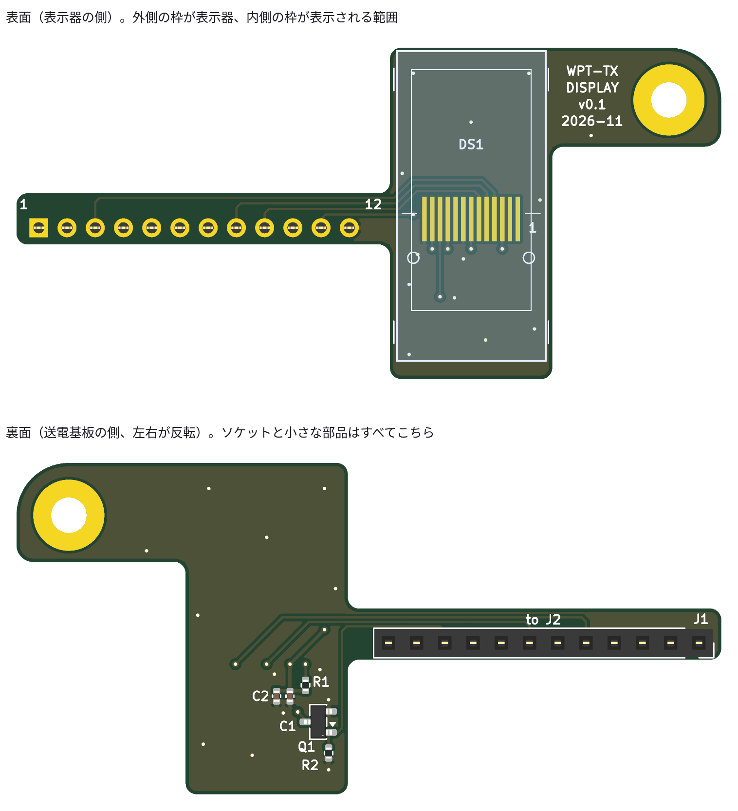

# 表示基板（仮設計）（2026-11-17）

送電基板（改訂 6）の J2 に挿す、表示用の子基板。KiCad のプロジェクトは `hardware/kicad/WPT-TX-DISPLAY`。電圧・電流・周波数などを表示するためのもので、操作は送電基板のエンコーダで行う。タッチパネルは無い。

「仮」としたのは、実物で組んで確かめていないため（§9）。回路図は ERC 0 件、基板は DRC（回路図との照合つき）0 件で、製造データも出力できる。

## 結論

- **送電基板は変えなくてよい。** J2 の位置・向き・ピン配置はそのままで成り立つ。
- **形は「帯 + ブロック + 腕」**（下の図）。J2 の上の細い帯、その東の USB コネクタの上に表示器を載せるブロック、右上の取付穴まで伸びる腕の 3 つからなる。支えは J2 のソケットと、右上の取付穴に立てる 11 mm のスペーサ。
- **アナログの確認点 3 個（TP301 = VSW_A、TP302 = VSW_B、TP303 = VTH）は隠れない。** 隠れるのは USB コネクタ（プラグは付けたまま挿せる）、水晶、クロック発生器、+3V3 / GND の確認点 1 組など、ディジタルと電源のものだけ（§1）。
- **表示器は 0.96 型の IPS TFT（80 × 160 画素、ST7735S、縦置き）**。3.3 V だけで動き、同じ端子のパネルが 3 社から出ている（§3）。
- **J2 は 1 列のままがよい**（§8.3）。2 列（2×6）にすると列が半分の長さになり、かえって支えが弱くなる。
- 弱い点は 2 つ。バックライトの明るさがパネルによって変わること（3.3 V では LED に余裕が無い、§4.2）と、表示器のフレキ（0.7 mm ピッチ、13 極）を手ではんだ付けすること（§6.2）。


青が表示基板。緑は表示基板を付けても使えるもの、橙は隠れるもの、赤の破線はつまみの大きさの上限。

## 1. 重なり方

座標は送電基板のもの（mm）。表示基板のデータも同じ座標で作ってあるので、2 枚のファイルを重ねるとそのまま位置が合う。

| 部分 | 範囲 | 大きさ | 役割 |
|---|---|---|---|
| 帯 | x 156.3〜189.9、y 138.4〜143.0 | 33.6 × 4.6 mm | 裏面に J2 用のソケット（J1）。信号をブロックへ運ぶ |
| ブロック | x 189.9〜204.5、y 125.3〜155.1 | 14.6 × 29.8 mm | 表面に表示器。裏面に小さな部品 5 個 |
| 腕 | x 204.5〜219.7、y 125.3〜134.2 | 15.2 × 8.9 mm | 右上の取付穴 (215, 130) の上のねじ穴（H1） |

全体は 63.4 × 29.8 mm、面積 7.2 cm²。送電基板の外形からはみ出さない（上辺で 0.3 mm 内側）。

### 1.1 隠れないもの

上から見たすき間。表示基板は 11 mm 上にあるので、すき間が小さい所はプローブを少し傾けて当てる。

| 対象 | 表示基板の縁からのすき間 |
|---|---|
| TP303（VTH、しきい値の直流電圧） | パッドの縁まで 4.9 mm |
| TP301（VSW_A、A 側の検出波形） | 1.5 mm |
| TP302（VSW_B、B 側の検出波形） | 0.6 mm |
| TP304（FLT3、ディジタル） | 1.5 mm |
| リセットスイッチ SW3 | 帯の北に 12 mm 離れている。上辺の外から横に押す |
| STDC14（J3）のケーブル側ソケット | 帯の西端から 1.7 mm。真上から抜き差しできる |
| 5 V のヘッダ CN208〜CN210 | 樹脂の北面から腕の南辺まで 1.0 mm |
| +3V3 / GND の確認点 TP224 / TP225 | 2.4 mm 以上 |
| エンコーダのつまみ | 軸から帯の南辺まで 7.6 mm。**つまみは直径 14 mm 以下**（§7） |

### 1.2 隠れるもの

USB-C コネクタ J5 と、その保護 IC（U3）・抵抗、水晶 X301、クロック発生器 U306 とそのまわりのコンデンサ・抵抗、3.3 V レギュレータ U206 の一部、+3V3 / GND の確認点 TP214 / TP215（同じものが TP224 / TP225 にある）、コンパレータ U308 / U309 の南の端と R335〜R338 の一部。LED、スイッチ、ジャンパは隠れない。

**USB は表示基板を付けたまま挿せる。** プラグの樹脂の上端は送電基板から約 4.9 mm、表示基板の下面は 11.0 mm で、6 mm 空いている。プラグをつまむ所は基板の外なので、表示基板は邪魔にならない。

### 1.3 表示器をつまみの真後ろに置かない

つまみの上端は約 28 mm、表示面は約 14 mm で、つまみのほうが 14 mm 高い。真後ろ（北）に置くと、斜め手前から見たときにつまみと手で隠れる。表示器をつまみの右奥に置けば、右手でつまみを回していても表示が見える。ブロックの西端はつまみの軸から 22 mm 東にあり、指は表示面より上を通る。

## 2. 高さ


南から見た図（西が左）。手前や奥にある部品（STDC14、USB のプラグ、5 V のヘッダ）は破線で重ねてある。

| 項目 | 送電基板の上面からの高さ | 根拠 |
|---|---|---|
| 表示基板の下面 / 上面 | 11.0 / 12.6 mm | J2 の樹脂 2.54 mm（Würth 61301211121）+ ソケット 8.5 mm（Würth 61301211821）、基板厚 1.6 mm |
| スペーサ | 11.0 mm | Harwin R30-1001102（M3、両側めねじ、対辺 5 mm）。ソケット側の 11.04 mm と 0.04 mm 差 |
| 表示器の上面 | 約 14.4 mm | パネル 1.5 mm + 両面テープ |
| 表示基板の裏面の部品の下端 | 9.9 mm | SOT-23（1.1 mm） |
| 表示基板の下で最も高い部品 | 3.3 mm（USB コネクタ）、プラグを挿すと約 4.9 mm | GCT の図面、プラグの樹脂は規格の最大 6.5 mm 厚 |
| STDC14: 挿したソケットの上端 | 7.6 mm | Samtec の図面 |
| エンコーダ: 本体 / 軸受け / 軸の先端 | 4.5 / 11.5 / 24.5 mm | Alps EC11E の図面 No.3 |

表示基板の表面では、J1 のはんだ付け部が帯の上に約 1.5 mm 出る。表示器はブロックの上にあるので当たらない。

## 3. 表示器

**0.96 型 IPS TFT、80 × 160 画素、コントローラ ST7735S、4 線 SPI、白色 LED 1 個のバックライト。** フレキ（幅 12.4 mm、13 極、0.7 mm ピッチ）を基板にはんだ付けする型で、コネクタは要らない。パネルは縦置き（短辺が上）で、表示される範囲は 10.8 × 21.7 mm。8 × 16 ドットの文字なら 10 字 × 10 行、16 × 32 ドットなら 5 字 × 5 行が入る。横置きにすると 5 V のヘッダを覆うので、縦にした。

この型を選んだ理由:

- ロジックもバックライトも 3.3 V で動く（VDD 2.5〜3.3 V、消費 2〜3 mA + LED 20 mA 以下）。J2 には 3.3 V しか無い。
- 外形 13.5 × 27.95 × 1.5 mm が、アナログの確認点の東・5 V のヘッダの西・ヒートシンクの北に、ちょうど収まる。
- 同じフレキ・同じピン配置のパネルが 3 社から出ている。

| 型番 | 外形 | 折り返したフレキの先端（パネルの端から） | LED の順電圧 | 在庫と価格（2026-11-17） |
|---|---|---|---|---|
| Wisevision N096-1608TBBIG11-H13（BOM の指定品） | 13.5 × 27.95 × 1.5 mm | 13.3 ± 0.5 mm | 2.9 / 3.0 / 3.1 V（15〜20 mA） | LCSC C2890616: 202 個、1 個 $1.86 |
| Midas MDT0096A2IS-SPI | 13.3 × 27.948 × 1.4 mm | 13.88 ± 0.5 mm | 3.2 V（15 mA） | Digi-Key（Marketplace）: 3,568 個、5 個単位で 1 個 967 円 |
| Focus LCDs E096GA-SW500-N | Midas と同じ図面 | 同上 | 2.7 / 3.1 / 3.4 V（20 mA） | Digi-Key（Marketplace）: 92 個、1 個 834 円 |

- 3 つとも、13 極・0.7 mm ピッチ（全幅 8.4 mm）・接点の長さ 2 mm・フレキの穴 2 個（10.4 mm 間隔、先端から 4.0 mm）が同じ。フットプリントはこの共通の寸法で作った。位置はフレキの穴で決めるので、Midas と Focus ではパネルが 0.58 mm 南へずれる。ブロックの南端はその分を見込んである。
- ピン: 1・2 NC（タッチ用、開放）、3 SDA、4 SCL、5 RS（D/C）、6 RESET、7 CS、8 GND、9 NC、10 VDD、11 LEDK、12 LEDA、13 GND。表示面を手前、フレキを下にして見ると、1 番が右。
- 秋月電子、スイッチサイエンス、aitendo、千石電商には、同じ裸のパネルは無かった（aitendo の AIR096A はこのパネルを載せた別の基板）。
- 0.8 mm ピッチの似たパネル（Display Visions EA TFT009-81AINN）は合わない。

## 4. 回路

回路図は 1 枚（`WPT-TX-DISPLAY.kicad_sch`）。部品は 7 個。

### 4.1 J2 の信号

| J2 のピン | 信号 | MCU のピン | この基板での使い方 |
|---|---|---|---|
| 1、12 | GND | — | 両方つなぐ |
| 2 | +3V3 | — | 使わない（11 番から取る） |
| 3 | SCK | PA5（SPI1_SCK） | 表示器の SCL |
| 4 | MISO | PA6 | 使わない（表示器へは書き込みだけ） |
| 5 | MOSI | PA7（SPI1_MOSI） | 表示器の SDA |
| 6 | ADC | PC2 | 使わない |
| 7 | CS | PA2 | 表示器の CS |
| 8 | DC | PA3 | 表示器の RS（データ / コマンド） |
| 9 | RST | PA4 | 表示器の RESET |
| 10 | IO | PB3（TIM2_CH2） | バックライトのオン・オフ（High で点灯、PWM で調光） |
| 11 | +3V3 | — | 表示器とバックライトの電源 |

全ピン 3.3 V 専用。J2 には 5 V と I2C が無い。

### 4.2 バックライト

+3V3 → R1（22 Ω）→ LED（パネルの中）→ Q1（N チャネル MOSFET、AO3400A）→ GND。R2（100 kΩ）がゲートを GND に引き、MCU がピンを駆動するまで消灯させておく（PB3 はリセット直後は浮いている）。

**3.3 V では LED に余裕が無い。** LED の順電圧は 2.9〜3.2 V 前後なので、抵抗にかかるのは 0.1〜0.4 V しかない。22 Ω だと、順電圧が最も低いパネル（2.9 V）で約 18 mA（定格は 20 mA）、3.0 V のパネルで約 14 mA、3.2 V のパネルではその半分以下になる。暗ければ R1 を小さくできるが、その前に実物の順電圧を測ること。明るさを揃えたいなら 5 V が要る（§8.6）。

### 4.3 グラウンドは J1 だけでつなぐ

ねじ穴 H1 のランドは、この基板のグラウンドにつないでいない。送電基板の取付穴はグラウンドなので、つなぐと金属のスペーサを通して 2 枚の基板の間に面積 6 cm² ほどの輪ができる。送電コイルのそばで使う基板なので、輪は作らないことにした。グラウンドは、信号が通る J1 の 1 番と 12 番でだけつながる。

## 5. 基板



- 2 層、厚さ 1.6 mm。線幅と間隔は 0.2 mm 以上、ビアは 0.6 / 0.3 mm（レジストで覆う）。送電基板と同じ設計ルールを使っている。
- 部品は表示器を除いてすべて裏面（送電基板の側）にある。実装は裏面の表面実装 5 個と、裏面に挿して表面からはんだ付けするソケット 1 個。
- 配線は 64 本・257 mm、ビア 19 個。すべて 0° / 45° / 90°。
- **帯の上の並べ方**: 信号は J1 のピンから北へ出て、帯に沿って東へ走る。表・裏とも 4 本ずつで、西のピンほど北の列を使うので交差が無い。SCK・DC・RST（表）はランドの北を回って北から入り、MOSI・CS（裏）はランドの下をくぐって南から入る。
- **SCK の真下にグラウンドの線を通した**（裏面の最も北の列、1 番ピンからブロックのグラウンドまで）。これが無いと、クロックの戻り電流は 11 mm 下の送電基板を通ることになり、帯のすぐ下にあるコンパレータの上に大きな輪ができる。
- 表示器のランドは 0.4 × 4.0 mm、13 個。フレキの先端より 1.5 mm 長くしてあり、そこにこてを当てる。ランドにはんだペーストは付けない（手はんだ）。表示器の裏は金属の枠なので、表示器の下にはこのランド以外の露出した銅が無い。
- グラウンドのベタは両面。J1 のグラウンドのピンと表示器のグラウンドのランドは、ベタではなく線でつないだ（はんだ付けのときに熱が逃げない）。

## 6. 部品と組立

### 6.1 部品

`fab/export.sh` が出す BOM（`fab/out/assembly/bom_pcbway.csv`）は 9 行。

| 記号 | 部品 | 型番 | 実装 |
|---|---|---|---|
| J1 | ソケット 1×12、2.54 mm、高さ 8.5 mm | Würth 61301211821 | 裏面、スルーホール |
| C1、C2 | 100 nF、1 µF（0402） | GCM155R71H104KE02D、CL05A105KA5NQNC | 裏面。送電基板と同じ型番 |
| R1、R2 | 22 Ω、100 kΩ（0402） | RC0402FR-0722RL、RC0402FR-07100KL | 裏面 |
| Q1 | N チャネル MOSFET、SOT-23 | AO3400A | 裏面。ゲートしきい値 1.5 V 未満・2.5 V で 0.2 Ω 以下の同等品でよい |
| DS1 | 表示器 | §3 | **実装業者は付けない。** 手で付ける |
| SP1 | 六角スペーサ M3 × 11 mm、両側めねじ | Harwin R30-1001102 | 基板データの外 |
| SC1、SC2 | ねじ M3 × 6 mm | — | 基板データの外 |

在庫（2026-11-17）: 61301211821 は Digi-Key に 6,221 個、R30-1001102 は 3,533 個、AO3400A は LCSC に 60 万個。ほかに、ポリイミドテープと両面テープが要る。

### 6.2 表示器の付け方

1. 実装済みの基板を、表面を上にして置く。南側に、基板と同じ厚さ（1.6 mm）の台を並べる。
2. 表示器を、**表示面を下にして**台の上に置き、フレキを基板のランドに載せる。フレキの 2 個の穴をシルクの 2 個の丸に、フレキの先端をシルクの線に合わせる。1 番はシルクの「1」の側（東）。
3. 13 極をはんだ付けする。ランドはフレキの先端から北へ 1.5 mm 出ているので、そこからはんだを流す。
4. はんだ付け部をポリイミドテープで覆う（表示器の裏は金属）。
5. ブロックの北半分に両面テープを貼り、表示器を南の辺を軸に起こして、基板の上へ折り返す。左右はシルクの短い縦線の間に合わせる。フレキをランドに合わせてあれば、北の端は基板の端の 0.3 mm ほど内側に来る。
6. 送電基板の右上の取付穴にスペーサを立て、J1 を J2 に挿して、H1 をねじで留める。

## 7. つまみ

軸は直径 6 mm の D カットで、平らな面までの厚みが 4.5 mm、平らな面の長さは先端から 10 mm。ローレット（ギザギザ）軸用のつまみは合わない。「6 mm D」とだけ書かれたつまみには、平らな面までが 5.0 mm のものがあり、ゆるくなる。

| つまみ | 外径 × 高さ | 固定 | 入手（2026-11-17） | 帯の南辺とのすき間 |
|---|---|---|---|---|
| サトーパーツ K-29-6.1 | 13.7 × 13.5 mm | 止めねじ（M3） | 秋月電子 | 0.75 mm |
| Same Sky SAK-007 | 10.8 × 13.5 mm | 押し込み（D 6 × 4.5） | Digi-Key | 2.2 mm |
| Same Sky SAK-020 | 10.6 × 13.5 mm | 押し込み（D 6 × 4.5） | Digi-Key | 2.3 mm |

- 寸法は販売店とメーカーのページの記載による（K-29-6.1 は外形図、ほかは商品ページ）。穴の深さは K-29-6.1 が 11.6 mm。SAK-007 の 9.6 mm は検索結果の表示で、図面では確かめていない。
- 止めねじ式は高さを選べる。下端が帯の上のはんだ付け部（約 14 mm）より上になる位置で止める。
- 候補の一覧と、外径が合わず外したものは `preorder_review.md` §7.5。

## 8. 検討して採らなかった案

### 8.1 J2 から北へ伸ばす長方形（同じ日の最初の検討）

31.5 × 18.0 mm の長方形を J2 から上辺まで伸ばし、左上の取付穴で支える案。アナログの確認点 TP301〜TP303 を覆うので採らなかった。立ち上げで必ず波形を見る所であり、表示基板を付けた状態で見られないのは困る。

### 8.2 表示器をつまみの奥に置く

§1.3 のとおり、つまみと手で隠れる。

### 8.3 J2 を 2 列にする

2×6 にすると、ピンの列の長さが 28 mm から 12.7 mm になる。この基板は、長い 1 列とその延長上のスペーサの 2 か所で支えるほうが、ねじれに強い。1 列だけだと列を軸に倒れる方向が弱いが、それはスペーサ（列から 11.5 mm 北）が受ける。2 列目を置く場所も無い（北はコンパレータと確認点、南はつまみ）。送電基板の変更も要る。

### 8.4 コネクタ式（ZIF）のパネル、1.14 型

- 同じ 0.96 型で 8 極・0.5 mm ピッチのコネクタ式（Wisevision N096-1608TBBIG09-C08）もある。パネルを差し替えられるが、入手先が LCSC だけで、フレキ（23 mm）を基板の端で裏へ回す必要がある。LED のカソードが内部で GND につながっているので、スイッチも変わる。
- スイッチサイエンスと千石電商にある M5Stack の 1.14 型パネル（135 × 240、17.6 × 31 mm、同じ 8 極）は、この位置に置くと 5 V のヘッダを覆い、南はヒートシンクの位置にかかる。
- はんだ付け式の 1.14 型（13 極）は、フレキの寸法とピン配置が同じだが、同じ理由で外形が収まらない。

### 8.5 OLED（0.96 型、128 × 64）

外形 26.7 × 19.3 mm は横長で、確認点か 5 V のヘッダのどちらかにかかる。また、内蔵の昇圧回路の電源は、多くのパネルで 3.5〜4.2 V と指定されている（SSD1306 の資料では 3.3 V から）。3.3 V での動作は仕様の端になる。

### 8.6 バックライトを 5 V で点ける

明るさをパネルによらず決められるが、J2 に 5 V が無い。方法は 2 つある: 腕を南へ広げて 5 V のヘッダ 1 個にソケットを挿す（ヘッダを 1 個使う）、または送電基板の J2 の 11 番を +5V に変える（送電基板の配線をやり直す）。室内で使う表示としては 3.3 V でも読めるはずなので、今回は採らなかった。実物で暗ければ検討する。

### 8.7 既製の表示モジュール

ピンヘッダ付きの 0.96 型モジュール（Adafruit 3533 など、32 × 28 × 6 mm）は入手しやすいが、厚みがあり、レギュレータとレベル変換が重複する。置き場所も変わらないので、裸のパネルにした。

## 9. 確かめていないこと

- **実物での組立。** フレキのはんだ付けのしやすさ、折り返したときの厚み（フレキの上に部品がある型がある）、両面テープの厚さ。どのメーカーも基板側のランドの寸法を示していないので、ランドはフレキの寸法から決めた。
- **バックライトの明るさ**（§4.2）。
- スペーサ（11.0 mm）とソケット（11.04 mm）を実物で組んだときの合い方。ピンとソケットのばらつきで 0.2 mm 程度は変わる。
- ファームウェア。ST7735S の 80 × 160 のパネルは、表示メモリの中の位置（オフセット）、色の順、反転の設定がパネルごとに違うことがある。実物で合わせる。SPI のクロックは低い周波数から始める。
- 在庫の数字のうち、Digi-Key のものは調査の担当（サブエージェント）がページから読んだ値で、Marketplace 品は出荷元がメーカーになる。LCSC のページと各パネルの図面は直接読んだ。AO3400A の Digi-Key の在庫数は読めなかった。
- +3V3 の余裕。この基板の消費は最大 23 mA 程度で、送電基板の見積もり（LDO 300 mA、基板側 60〜100 mA）からは問題ないが、実測していない。

## 10. 作り方

```sh
cd hardware/kicad/WPT-TX-DISPLAY
sh tools/build.sh      # 回路図 → ERC → ネットリスト → 基板 → DRC
sh fab/export.sh       # ガーバー、ドリル、BOM、部品座標、図面を fab/out/ へ
```

回路図と基板はスクリプトが書く（`tools/gen_sch.py`、`tools/make_board.py`）。寸法や定数を変えるときはスクリプトを直して作り直す。KiCad で開いて手で直してもよいが、その場合はスクリプトを再実行すると上書きされる。フットプリントは `tools/make_footprint.py`、このページの図は `tools/drawings.py` が作る。

参照した資料: Wisevision N096-1608TBBIG11-H13 の仕様書（Ver B）、Midas MDT0096A2IS-SPI の仕様書（Version 1）、Würth 61301211821 / 61301211121 の図面、Harwin R30-1001102（Digi-Key の商品ページ）、AOS AO3400A のデータシート（Rev 3.1）、送電基板側は `preorder_review.md` §7.9。
