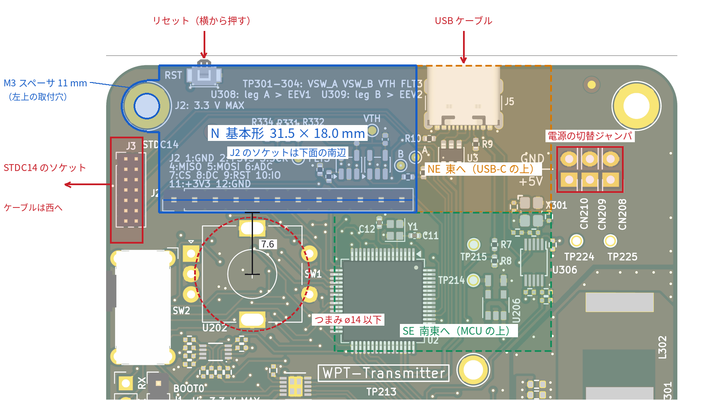
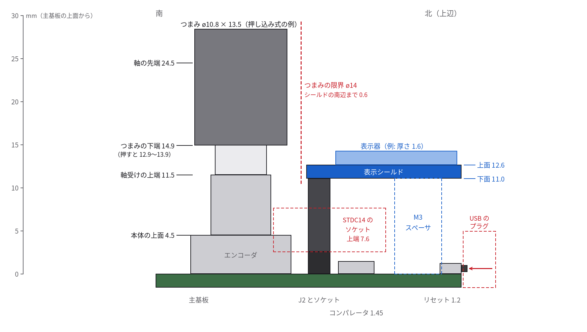

# 表示シールドの形: 最初の検討（2026-11-17）

J2（1×12）に挿す表示用の子基板（以下「シールド」）について、主基板（改訂 6）の側から決まる条件を整理し、最初の案を出す。目的は 2 つある。主基板を発注する前に「J2 がこの位置で困らないか」を確かめること、シールドの設計を始めるときの出発点にすること。

## 結論

- **主基板は今のままでよい。** J2 の位置・向き・ピン配置を変えなくても、31.5 × 18.0 mm のシールドを 2 点（J2 のソケットと、左上の取付穴に立てる 11 mm のスペーサ）で支えられる。STDC14 のケーブル、USB ケーブル、リセットスイッチ、エンコーダのつまみのどれにも当たらない。
- **最初の案は基本形 N**: J2 から北へ伸びる長方形。収まる表示器は 0.96〜1.14 型の小型 TFT か、0.96 型の OLED まで。
- それより大きい表示器（1.3 型級）にするなら、東（NE）と南東（SE）へ広げる。高さの干渉は無いが、USB コネクタと MCU の上を覆う。
- **決めてほしいのは表示器の大きさ。** もう 1 点、J2 には I2C と 5 V が出ていない。タッチパネルや I2C の表示器を使う予定があるなら、主基板の発注前に J2 の割り当てを変える必要がある。

青が基本形 N、橙と緑の破線が広げられる範囲、赤がシールドを置けない所・空けておく所。

## 1. 主基板から決まること

### 1.1 J2 の信号

| ピン | 信号 | MCU のピン | 使い道 |
|---|---|---|---|
| 1、12 | GND | — | |
| 2、11 | +3V3 | — | 表示器とバックライトの電源（§1.4） |
| 3 | SCK | PA5（SPI1_SCK） | |
| 4 | MISO | PA6（SPI1_MISO） | |
| 5 | MOSI | PA7（SPI1_MOSI） | |
| 6 | ADC | PC2（ADC1 / ADC2 の IN8） | アナログ入力。抵抗分圧式のボタン、明るさセンサなど |
| 7 | CS | PA2 | |
| 8 | DC | PA3 | |
| 9 | RST | PA4 | 表示器のリセット |
| 10 | IO | PB3 | 汎用。TIM2_CH2 を出せるので、バックライトの PWM に使える |

- 全ピン 3.3 V 専用で、5 V トレラントではない（基板のシルクにも「J2: 3.3 V MAX」）。
- **J2 に無いもの**: 5 V と I2C。I2C（電流計 PAC1720 などのバス）は基板上にあるが、J2 には出していない。

### 1.2 平面: どこまで使えるか

座標は主基板のもの（mm）。「1 番ピン基準」は J2 の 1 番ピンを原点にした値で、x は東、y は北が正。シールドを設計するときはこちらを使う。

| 範囲 | 主基板の座標 | 1 番ピン基準 | 下にあるもの | 注意 |
|---|---|---|---|---|
| **N 基本形** | x 156.5〜188.0、y 125.0〜143.0（31.5 × 18.0） | x −1.8〜+29.7、y −1.5〜+16.5 | コンパレータ（1.45 mm）、リセットスイッチ（1.2 mm）、テストパッド | テストパッド TP301〜TP304 には触れなくなる |
| スペーサ用の耳 | 中心 (155.0, 130.0)、半径 3.2 | 中心 (−3.3, +11.5) | 左上の取付穴 | STDC14 のソケットの北端まで 0.6 mm |
| NE 東へ | x 188.0〜204.5、y 125.0〜143.0（16.5 × 18.0） | x +29.7〜+46.2 | USB-C コネクタ（3.3 mm）、挿したプラグ（約 5 mm） | USB の抜き差しが見えにくくなる |
| SE 南東へ | x 178.0〜204.5、y 143.0〜160.0（26.5 × 17.0） | x +19.7〜+46.2、y −18.5〜−1.5 | 水晶、MCU（1.6 mm）、TP214 / TP215 | つまみの軸から 10 mm。つまみは細いものにする |

置けない所:

| 場所 | 理由 |
|---|---|
| x 150.5〜154.6、y 133.8〜146.8（1 番ピン基準で x < −3.7） | STDC14 のケーブル側ソケット（13.1 × 3.1 mm にキー 1.0 mm、上端 7.6 mm）。真上から抜き差しするので覆わない |
| エンコーダの軸 (167.9, 150.6) から半径 7.6 mm（1 番ピン基準で (+9.6, −9.1)） | つまみ |
| x 205 より東（CN208〜CN210） | 電源の切替ジャンパ。挿し替えるので覆わない |
| y 160 より南 | 電力段（発熱と高電圧） |

- **南辺 y = 143.0** は、J2 のソケットの樹脂（y 142.77 まで）のすぐ外。ここから軸まで 7.6 mm なので、**つまみは直径 14 mm 以下**（すき間 0.6 mm）。10〜12 mm のつまみなら指が入りやすい（§4）。
- **西辺 x = 156.5** は、STDC14 のソケットの東面（x 154.6）から 1.9 mm。耳の部分だけが西へ出る。耳はソケットの北にあるので、シールドを付けたままケーブルを抜き差しできる。
- **北辺 y = 125.0** は主基板の上辺と同じ位置。リセットスイッチ SW3（x 160.5〜163.5）は上辺から横向きに押すので、その上でシールドを北へ張り出すと押しにくくなる。張り出すなら x 165 より東にする。

### 1.3 高さ

東から見た図。違う x にある部品（STDC14 のソケット、スペーサ、USB のプラグ）は破線で重ねてある。

| 項目 | 主基板の上面からの高さ | 根拠 |
|---|---|---|
| シールドの下面 / 上面 | 11.0 / 12.6 mm | J2 の樹脂 2.54 mm（Würth 61301211121 の図面）+ 高さ 8.5 mm の一般的な 1 列ソケット、基板厚 1.6 mm |
| N の下で最も高い部品 | 1.45 mm | コンパレータ（SOT-23-5） |
| STDC14: シュラウドの上端 / 挿したソケットの上端 | 5.7 / 7.6 mm | Samtec の図面（樹脂 2.51 + シュラウド 3.20、ソケット 5.08 mm） |
| USB-C: コネクタ / 挿したプラグの上端 | 3.3 / 約 5 mm | GCT の図面（3.31 mm）、プラグの外形（規格の最大厚 6.5 mm） |
| エンコーダ: 本体 / 軸受け / 軸の先端 | 4.5 / 11.5 / 24.5 mm | Alps EC11E のカタログ、図面 No.3 |
| 軸の平らな面（D カット） | 先端から 10 mm（高さ 14.5〜24.5 mm） | 同上 |
| 押し込みの行程 | 1.5 ± 0.5 mm | 同上 |

- シールドの下は、J2 の列を除いて 9.5 mm 空いている。シールドの下面にも部品を置ける。
- 軸受けの上端（11.5 mm）はシールド（11.0〜12.6 mm）とほぼ同じ高さにある。つまみの下端はシールドの上面より上に来るが、押し込むと下がる（下端 14.9 mm のつまみで 12.9〜13.9 mm）。**つまみとシールド・表示器は、上から見て重ならないようにする。**
- スペーサは M3 × 11 mm（両めねじの六角スペーサ）。10 mm や 12 mm でも挿さるが、ソケットの掛かりが 1 mm 変わる。

### 1.4 電源

+3V3 は 300 mA の LDO（MIC5504、SOT-23-5、5 V から降圧）で、MCU などと共用している。基板側の消費は、見積もりで 60〜100 mA（MCU、コンパレータ 2 個、I2C の部品。Legacy 構成ではクロック発生器が加わる）。LDO の発熱（1.7 V × 電流）から考えて、**シールドの消費は 80 mA 程度までを目安にする**。小型 TFT のバックライト（LED 1 個、20 mA 前後）や OLED は収まる。LED を 3〜4 個並べた 2 型級のバックライトは、これを超える。この数字は見積もりで、実測していない。

## 2. 最初の案: 基本形 N

- **外形**: 31.5 × 18.0 mm の長方形に、スペーサ用の耳（左上の取付穴のまわり、半径 3.2 mm）を付ける。
- **支え**: 南辺の下面に 1×12 のソケット、北西の耳に M3 × 11 mm のスペーサ。J2 の 1 列だけで支えると、北側を押したときにピンの列を軸に回ってしまう。
- **北東の角は浮く**（スペーサから 33 mm、J2 の列から 16.5 mm）。表示だけなら問題にならない。押しボタンを置くなら J2 の列の近くにする。
- **収まる表示器**（一般に流通しているパネルの外形の目安。個々の型番の図面では確かめていない）:

| 表示器 | 外形の目安 | N に収まるか |
|---|---|---|
| 0.96 型 TFT 80 × 160（ST7735S） | 13.5 × 28 mm | 収まる。J2 のはんだ付け部を避けても余る |
| 1.14 型 TFT 135 × 240（ST7789） | 17.6 × 31 mm | ちょうど。ソケットを表面実装品にするか、北へ 2 mm 張り出す |
| 0.96 型 OLED 128 × 64（SSD1306） | 26.7 × 19.3 mm | 北へ 1〜3 mm 張り出す |
| 1.3 型 OLED 128 × 64（SH1106） | 34.5 × 23 mm | 入らない。NE へ 3 mm、北へ 5 mm 要る |
| 1.3 型 TFT 240 × 240 | 26 × 29 mm | 入らない（§3） |

- フレキ（FPC）の引き出しを含めると、幅が足りなくなるパネルが多い。その分は東（NE、USB コネクタの上）へ伸ばす。

## 3. 広げる場合

- **NE（東へ 16.5 mm）**: USB-C コネクタの上にかぶさる。プラグの上端が約 5 mm、シールドの下面が 11.0 mm なので当たらない。N + NE で 48 × 18 mm になる。
- **SE（MCU の上）**: NE と N の東端から南へ 17 mm。x 178.0〜204.5 に 26.5 × 35 mm の面が取れ、1.3 型 TFT（240 × 240）級が入る。つまみの軸から 10 mm の所から始まるので、つまみは 11 mm 以下の細いものにする。
- これ以上（1.5 型以上、または操作ボタンを多数）にするなら、シールドではなく、ケーブルでつなぐ表示基板にするほうが無理がない。
- どの形でも、支えは J2 と左上のスペーサになる。右上の取付穴 (215, 130) まで伸ばすと、電源の切替ジャンパを覆う。

## 4. つまみ

軸は直径 6 mm の D カットで、平らな面までの厚みが 4.5 mm、平らな面の長さは先端から 10 mm。ローレット（ギザギザ）軸用のつまみは合わない。「6 mm D」とだけ書かれたつまみには、平らな面までが 5.0 mm のものがあり、ゆるくなる。

| つまみ | 外径 × 高さ | 固定 | 入手（2026-11-17） | シールドの南辺とのすき間 |
|---|---|---|---|---|
| サトーパーツ K-29-6.1 | 13.7 × 13.5 mm | 止めねじ（M3） | 秋月電子 | 0.75 mm |
| Same Sky SAK-007 | 10.8 × 13.5 mm | 押し込み（D 6 × 4.5） | Digi-Key | 2.2 mm |
| Same Sky SAK-020 | 10.6 × 13.5 mm | 押し込み（D 6 × 4.5） | Digi-Key | 2.3 mm |

- 寸法は販売店とメーカーのページの記載による（K-29-6.1 は外形図、ほかは商品ページ）。穴の深さは K-29-6.1 が 11.6 mm。SAK-007 の 9.6 mm は検索結果の表示で、図面では確かめていない。
- 止めねじ式は高さを選べる。下端がシールドの上面（12.6 mm）より 2 mm 以上高くなる位置で止める。
- 候補の一覧と、外径が合わず外したものは `preorder_review.md` §7.5。

## 5. 決めること・確かめていないこと

1. 表示器の種類と大きさ（N に収めるか、広げるか）。
2. I2C や 5 V が要るか。要るなら主基板の J2 を変える（発注前）。
3. 確かめていないこと: パネル個々の外形と FPC の位置、+3V3 の実際の余裕、スペーサとソケットを実物で組んだときの高さの合い方。

2 枚の図は `hardware/kicad/WPT-TX/tools/layout/shield_study.py` が基板ファイルから作る。
