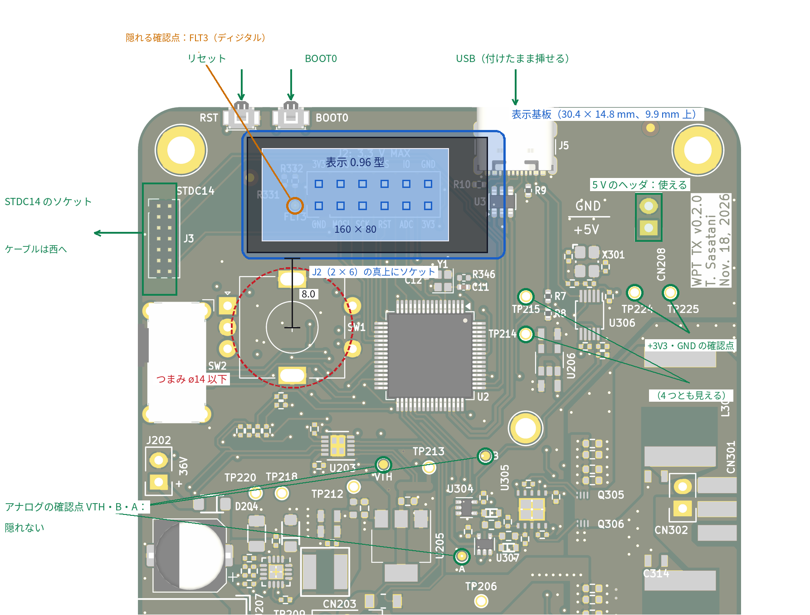
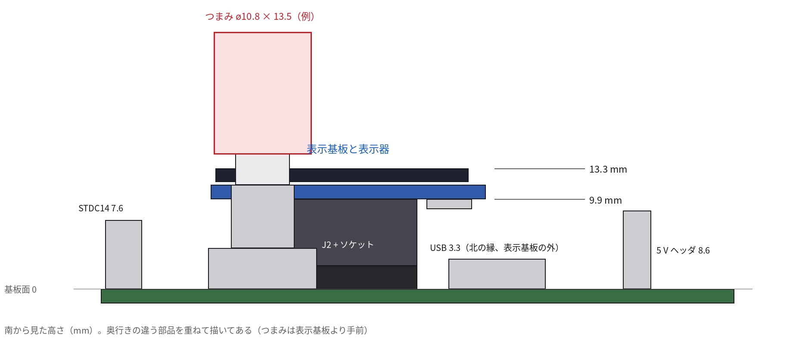

# 表示基板（仮設計 v0.2）（2026-11-17）

送電基板（改訂 7）の J2 に挿す、表示用の子基板。KiCad のプロジェクトは `hardware/kicad/WPT-TX-DISPLAY`。電圧・電流・周波数などを表示するためのもので、操作は送電基板のエンコーダで行う。タッチパネルは無い。

「仮」としたのは、実物で組んで確かめていないため（§8）。回路図は ERC 0 件、基板は DRC（回路図との照合つき）0 件で、製造データも出力できる（`hardware/kicad/release/WPT-TX-DISPLAY_v0.2.zip`）。

v0.1（同じ日の午前、送電基板 改訂 6 用）は、1 列 12 ピンの J2 に合わせた「帯 + 張り出し + 腕」の形で、スペーサで支えていた。送電基板の改訂 7 で J2 を 2 列にして上辺の帯へ移したので、作り直した。

## 結論

- **形は 30.4 × 14.8 mm の長方形**（下の図）。表示器（横置き）とほぼ同じ大きさで、裏面の中央に J2 用のソケットがある。
- **支えは J2 のソケットだけ。ねじもスペーサも無い。** ピンは 2 列 × 6 本で基板の中央にあり、どの端を押しても腕の長さは 15 mm 以下。
- **ソケットは表面実装品**（Samtec SSM-106-L-DV、高さ 7.37 mm）。表面にはんだ付け部が出ないので、表示器をソケットの真上に載せられる。スルーホールのソケットではこれができず、v0.1 の形になっていた。
- **アナログの確認点 3 個（TP301 = VSW_A、TP302 = VSW_B、TP303 = VTH）は隠れない**（MCU の南にある）。下に入るのは FLT3 の確認点（TP304、ディジタル）と FLT3 の抵抗 2 個、フィデューシャル 1 個、USB コネクタの西の端だけ（プラグは付けたまま挿せる）。リセットスイッチ、STDC14、5 V のヘッダ、+3V3 / GND の確認点は外に出ている。
- **表示器は 0.96 型の IPS TFT（160 × 80 画素、ST7735S）**。3.3 V だけで動き、同じ端子のパネルが 3 社から出ている（§3）。
- 弱い点は 2 つ。バックライトの明るさがパネルによって変わること（3.3 V では LED に余裕が無い、§4.2）と、表示器のフレキ（0.7 mm ピッチ、13 極）を手ではんだ付けすること（§6.2）。



青が表示基板。緑は表示基板を付けても使えるもの、橙は隠れるもの、赤の破線はつまみの大きさの上限。

## 1. 重なり方

表示基板の範囲は、送電基板の座標で x = 162.15〜192.55、y = 127.75〜142.55（上辺から 2.75 mm 内側）。

- **隠れないもの**: リセットスイッチ SW3（基板の北西の角の外。横から押す）、STDC14（J3）、エンコーダ、5 V のヘッダ CN208〜CN210、水晶とクロック発生器、+3V3 / GND の確認点 TP214 / TP215 / TP224 / TP225、アナログの確認点 TP301〜TP303。
- **下に入るもの**: TP304（FLT3 の入力、ディジタル）、R331 / R332、FID1、USB の CC 抵抗 R10 と ESD 保護 IC（U3）の一部、USB コネクタの西の端 約 4 mm（高さ 3.3 mm、表示基板の下面まで 6.6 mm）。どれも触る必要の無い部品。USB のプラグは送電基板の縁の外にあり、表示基板の下には入らないので、付けたまま挿せる。
- つまみ: 軸の中心から表示基板の南辺まで 8.0 mm。直径 14 mm（半径 7 mm）までのつまみなら、上から見て重ならない（§7）。

## 2. 高さ



| 項目 | 高さ（送電基板の表面から） | 出どころ |
|---|---|---|
| J2 のピンヘッダの絶縁体 | 2.54 mm | Würth WR-PHD（61301221121） |
| ソケット（J1） | +7.37 mm | Samtec SSM-DV（カタログ F-226） |
| 表示基板の下面 | **9.9 mm** | 上の和 |
| 表示基板の上面 | 11.5 mm | 基板 1.6 mm |
| 表示器の上面 | **13.3 mm** | テープ 0.3 mm + パネル 1.5 mm |
| 表示基板の下にある部品の最大 | 3.3 mm（USB コネクタ） | GCT USB4105 |
| 表示基板の裏面の部品 | 下面から 1.1 mm 下まで（Q1） | SOT-23 |

ピンヘッダのピンは絶縁体の上に約 6 mm 出ていて（2.54 mm ピッチの一般的な寸法）、ソケットには 4.3〜7.2 mm 入ればよい（Samtec の記載）。

## 3. 表示器

**0.96 型 IPS TFT、80 × 160 画素、コントローラ ST7735S、4 線 SPI、白色 LED 1 個のバックライト。** フレキ（幅 12.4 mm、13 極、0.7 mm ピッチ）を基板にはんだ付けする型で、コネクタは要らない。パネルは横置き（長辺が横）で、表示される範囲は 21.7 × 10.8 mm（160 × 80 画素）。8 × 16 ドットの文字なら 20 字 × 5 行、16 × 32 ドットなら 10 字 × 2 行が入る。向きはファームウェア（ST7735S の MADCTL）で決める。

この型を選んだ理由:

- ロジックもバックライトも 3.3 V で動く（VDD 2.5〜3.3 V、消費 2〜3 mA + LED 20 mA 以下）。J2 には 3.3 V しか無い。
- 外形 13.5 × 27.95 × 1.5 mm が、送電基板の上辺の帯（リセットスイッチの東、5 V のヘッダの西）に横向きで収まる。
- 同じフレキ・同じピン配置のパネルが 3 社から出ている。

| 型番 | 外形 | 折り返したフレキの先端（パネルの端から） | LED の順電圧 | 在庫と価格（2026-11-17） |
|---|---|---|---|---|
| Wisevision N096-1608TBBIG11-H13（BOM の指定品） | 13.5 × 27.95 × 1.5 mm | 13.3 ± 0.5 mm | 2.9 / 3.0 / 3.1 V（15〜20 mA） | LCSC C2890616: 202 個、1 個 $1.86 |
| Midas MDT0096A2IS-SPI | 13.3 × 27.948 × 1.4 mm | 13.88 ± 0.5 mm | 3.2 V（15 mA） | Digi-Key（Marketplace）: 3,568 個、5 個単位で 1 個 967 円 |
| Focus LCDs E096GA-SW500-N | Midas と同じ図面 | 同上 | 2.7 / 3.1 / 3.4 V（20 mA） | Digi-Key（Marketplace）: 92 個、1 個 834 円 |

- 3 つとも、13 極・0.7 mm ピッチ（全幅 8.4 mm）・接点の長さ 2 mm・フレキの穴 2 個（10.4 mm 間隔、先端から 4.0 mm）が同じ。フットプリントはこの共通の寸法で作った。位置はフレキの穴で決めるので、Midas と Focus ではパネルが 0.58 mm 東へずれる。基板の東端はその分を見込んである。
- ピン: 1・2 NC（タッチ用、開放）、3 SDA、4 SCL、5 RS（D/C）、6 RESET、7 CS、8 GND、9 NC、10 VDD、11 LEDK、12 LEDA、13 GND。表示面を手前、フレキを下にして見ると、1 番が右。
- 秋月電子、スイッチサイエンス、aitendo、千石電商には、同じ裸のパネルは無かった（aitendo の AIR096A はこのパネルを載せた別の基板）。
- 0.8 mm ピッチの似たパネル（Display Visions EA TFT009-81AINN）は合わない。

## 4. 回路

回路図は 1 枚（`WPT-TX-DISPLAY.kicad_sch`）。部品は 7 個。

### 4.1 J2 の信号（送電基板 改訂 7）

| ピン | 信号 | MCU | この基板での使い方 |
|---|---|---|---|
| 1、12 | GND | | グラウンド |
| 2、11 | +3V3 | | 11 番から取る（2 番は未接続） |
| 3 | MOSI | PA7（SPI1） | 表示器のデータ |
| 4 | MISO | PA6 | 未接続（表示器へは書き込みだけ） |
| 5 | SCK | PA5 | 表示器のクロック |
| 6 | DC | PA3 | データ / コマンド |
| 7 | RST | PA4 | リセット（Low で有効） |
| 8 | CS | PA2 | チップセレクト（Low で有効） |
| 9 | ADC | PC2 | 未接続 |
| 10 | IO | PB3（TIM2_CH2） | バックライトのスイッチ（High で点灯、PWM で調光） |

奇数ピンが内側（MCU 側）の列、偶数ピンが外側（上辺側）の列。

### 4.2 バックライト

白色 LED 1 個で、順電圧 2.9〜3.1 V（15〜20 mA、Wisevision）。3.3 V からでは 0.2〜0.4 V しか余らないので、スイッチは 2.5 V 駆動で数十 mΩ の MOSFET（AO3400A）にし、電流は R1（22 Ω）と LED だけで決まる: LED が 3.0 V なら約 14 mA、2.9 V なら 18 mA（上限 20 mA なので R1 をこれより小さくしない）、3.2 V のパネル（Midas）では半分以下になる。明るさがパネルで変わるのは、3.3 V だけで動かす代償（J2 に 5 V は無い）。R2（100 kΩ）は、ファームウェアが PB3 を駆動するまでバックライトを消しておく。

### 4.3 グラウンド

グラウンドは J1 の 1 番と 12 番だけで送電基板につながる。ほかに 2 枚の基板をつなぐ金属は無いので、6.78 MHz のコイルのそばで基板の間にループはできない。

## 5. 基板


- 2 層、1.6 mm、30.4 × 14.8 mm、角は R1。規則は送電基板と同じ（線幅 / 間隔 0.2 / 0.2 mm、ビア 0.6 / 0.3 mm）。
- 表面: 中央に表示器のフレキのランド 13 本（0.4 × 4.0 mm、0.7 mm ピッチ）。ほかは配線とグラウンドのベタだけで、表示器の金属の裏面が載る。
- 裏面: 中央にソケット J1、その東に小さな部品 5 個（C1、C2、R1、Q1、R2）。
- 配線: MOSI / SCK / RST はランドの西へ出て南へ回り、内側の列のパッドのすぐ下でビアを通って裏面へ。DC / CS はランドの東（フレキの下）へ出て北へ回り、外側の列のパッドのすぐ上で裏面へ。電源とバックライトは東へ出て、裏面の部品へ。同じ層の上で交差する線は無い。
- 座標は送電基板と同じにしてある（この基板の点 (x, y) は、送電基板の同じ点の 9.9 mm 上）。ソケットのランドが J2 の各ピンの真上（列の方向に同じ位置、列と直角の方向に 1.25 mm 外）にあることは、図を作るスクリプト（`tools/drawings.py`）が確かめている。

## 6. 部品と組立

### 6.1 部品

`fab/export.sh` が出す BOM（`fab/out/assembly/bom_pcbway.csv`）は 7 行。

| 記号 | 部品 | 型番 | 実装 |
|---|---|---|---|
| J1 | ソケット 2 × 6、2.54 mm、表面実装、高さ 7.37 mm | Samtec SSM-106-L-DV（めっきが薄い SSM-106-F-DV でもよい） | 裏面 |
| C1、C2 | 100 nF、1 µF（0402） | GCM155R71H104KE02D、CL05A105KA5NQNC | 裏面。送電基板と同じ型番 |
| R1、R2 | 22 Ω、100 kΩ（0402） | RC0402FR-0722RL、RC0402FR-07100KL | 裏面 |
| Q1 | N チャネル MOSFET、SOT-23 | AO3400A | 裏面。ゲートしきい値 1.5 V 未満・2.5 V で 0.2 Ω 以下の同等品でよい |
| DS1 | 表示器 | §3 | **実装業者は付けない。** 手で付ける |

ほかに、ポリイミドテープと両面テープが要る。実装は裏面だけ（表示器を除く）。

### 6.2 表示器の付け方

1. 実装済みの基板を、表面を上にして置く。東側に、基板と同じ厚さ（1.6 mm）の台を並べる。
2. 表示器を、**表示面を下にして**台の上に置き、フレキを基板の中央のランドに載せる。フレキの 2 個の穴をシルクの 2 個の丸に、フレキの先端をシルクの線に合わせる。1 番はシルクの「1」の側（北）。
3. 13 極をはんだ付けする。ランドはフレキの先端から西へ 1.5 mm 出ているので、そこからはんだを流す。
4. はんだ付け部をポリイミドテープで覆う（表示器の裏は金属）。
5. 基板の西半分に両面テープを貼り、表示器を東の辺を軸に起こして、基板の上へ折り返す。テープの厚さは、はんだ付け部の盛り上がり（0.3〜0.5 mm 程度の見込み）に合わせると、表示器が傾かない。上下はシルクの短い線の間に合わせる。
6. J1 を J2 に挿す。**向きに注意: 表示器のフレキの折り返しが東（USB コネクタの側）。** 基板が J2 に対して対称なので、逆向きにも挿さってしまう。電源ピン（1・12 = GND、2・11 = +3V3）は逆向きでも同じ位置に来るので壊れないが、表示は出ない。

外すときは、基板の中央（ソケットの上）の両縁を持ってまっすぐ上へ抜く。

## 7. つまみ

軸は直径 6 mm の D カットで、平らな面までの厚みが 4.5 mm、平らな面の長さは先端から 10 mm。ローレット（ギザギザ）軸用のつまみは合わない。「6 mm D」とだけ書かれたつまみには、平らな面までが 5.0 mm のものがあり、ゆるくなる。

| つまみ | 外径 × 高さ | 固定 | 入手（2026-11-17） | 表示基板の南辺とのすき間 |
|---|---|---|---|---|
| サトーパーツ K-29-6.1 | 13.7 × 13.5 mm | 止めねじ（M3） | 秋月電子 | 1.2 mm |
| Same Sky SAK-007 | 10.8 × 13.5 mm | 押し込み（D 6 × 4.5） | Digi-Key | 2.65 mm |
| Same Sky SAK-020 | 10.6 × 13.5 mm | 押し込み（D 6 × 4.5） | Digi-Key | 2.75 mm |

- 寸法は販売店とメーカーのページの記載による（K-29-6.1 は外形図、ほかは商品ページ）。穴の深さは K-29-6.1 が 11.6 mm。SAK-007 の 9.6 mm は検索結果の表示で、図面では確かめていない。
- つまみは表示基板の南にあり、上から見て重ならない（軸の中心から表示基板の南辺まで 8.0 mm）。直径 14 mm までなら高さの制約は無い。
- 候補の一覧と、外径が合わず外したものは `preorder_review.md` §7.5。

## 8. 確かめていないこと

- **実物では組んでいない。** とくに、フレキのはんだ付け部の盛り上がりと両面テープの厚さの釣り合い、ソケットだけで支えたときのがたつき。
- ソケット SSM-106-L-DV のランドは KiCad の標準フットプリント（`PinSocket_2x06_P2.54mm_Vertical_SMD`、ランド 3.0 × 1.0 mm、外側の幅 8.04 mm）で、カタログのリードの幅 7.04 mm が入ることだけを確かめた。メーカーの推奨ランド図は取得できなかった。
- バックライトの明るさ（パネルの LED の順電圧による）。
- パネルの在庫と価格は 2026-11-17 の値（§3）。
- 表示の向きと色の並び（ST7735S の設定）はファームウェアの仕事で、まだ書いていない。

## 9. 作り方

```sh
cd hardware/kicad/WPT-TX-DISPLAY
sh tools/build.sh        # 回路図 → ERC → ネットリスト → 基板 → DRC。終了コード 0 なら 0 件
sh fab/export.sh         # fab/out/ に製造データ
python3 tools/drawings.py ../WPT-TX/WPT-01-TRANSMITTER.kicad_pcb WPT-TX-DISPLAY.kicad_pcb \
    ../../../docs/stm32-tx/img/display_plan.png ../../../docs/stm32-tx/img/display_side.png ../../../docs/stm32-tx/img/display_board.png
```

回路図も基板もスクリプトが書く（`tools/gen_sch.py`、`tools/make_board.py`）。寸法を変えるときはスクリプトの定数を直して作り直す。
