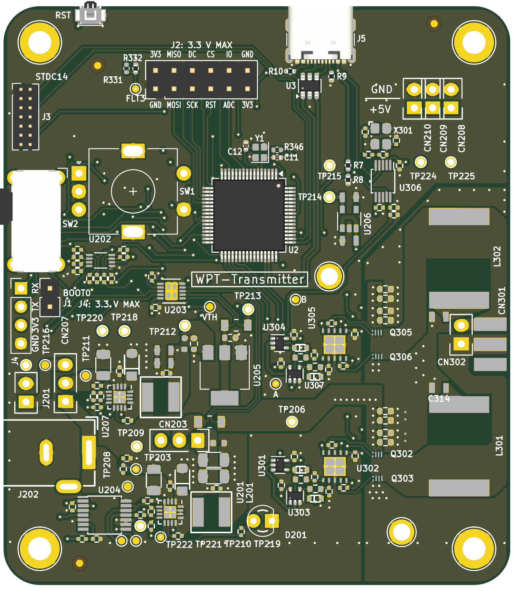
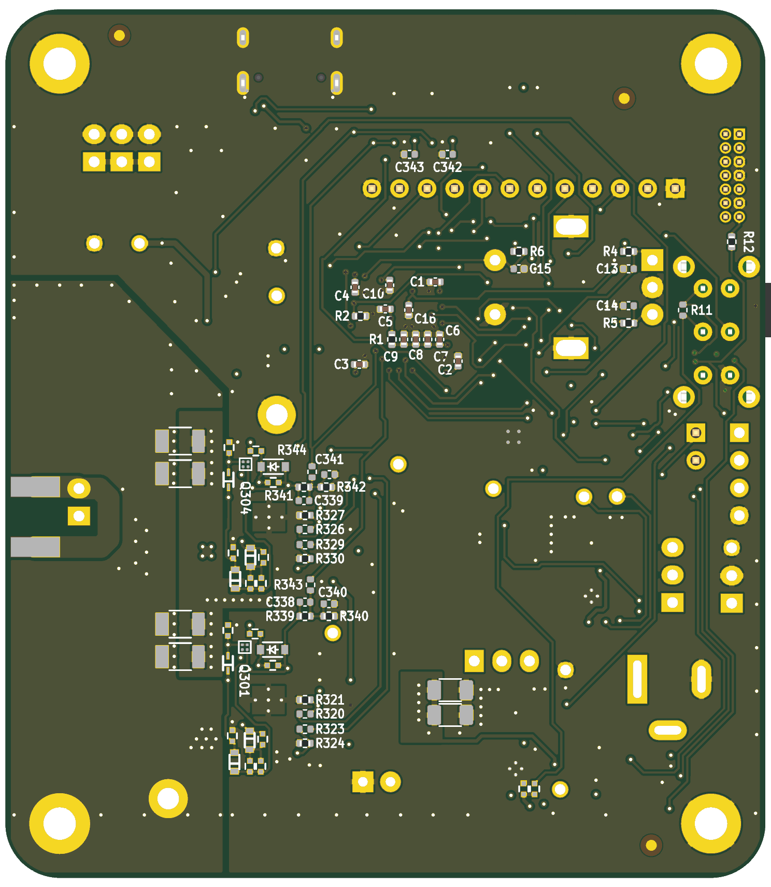

# STM32 部の配置・配線メモ（2026-11-17 改訂 7）

`hardware/kicad/WPT-TX/WPT-01-TRANSMITTER.kicad_pcb` の MCU / UI 部（Arduino Nano と入れ替えた範囲）について、何をどういう考えで配置・配線したか、検証結果、発注前に人の目で見てほしい点をまとめる。
電力段（GaN ハーフブリッジ、ゲートドライバ、電源）の銅箔は、下に書く数か所を除いて元のまま。




## 1. 結論

改訂 7 で変えたこと（改訂 6 = コミット `54b4246` との差）。以前の形に合わせていたために遠回りになっていた所を、置き場所から直した。作業は `tools/schematic/edit_sch11.py` と `tools/layout/rev7.sh`（`mech11.py`、`mech12.py`、`mech13.py`）:

- **スイッチノードのコンパレータ（U308 / U309）を、上辺から MCU の南側の裏面へ移した**（§5.7）。ハーフブリッジからコンパレータまでの線は A 側 80 → 19.2 mm、B 側 55 → 10.8 mm。分圧の下側の脚（1 kΩ ∥ 47 pF）をコンパレータの入力に置いたので、分圧とコンパレータが同じグラウンドを基準にする。MCU 内蔵コンパレータへの枝（PA1 / PC1）は外した。
- **コンパレータの出力の行き先を入れ替えた**: A 側（U308）→ HRTIM1_EEV2（PC11）、B 側（U309）→ HRTIM1_EEV1（PC12）。MCU の下で西側のビアからは 54 番ピンにしか届かないため。ファームウェアの割り当ては `hrtim_timing_control.md` の 7.11 節。
- **J2 を 2 × 6（2.54 mm）にして、コンパレータの跡地へ移した**（§3.8）。ピンの信号は、MCU から線が届く順に並べ直した: 1 GND、2 +3V3、3 MOSI、4 MISO、5 SCK、6 DC、7 RST、8 CS、9 ADC、10 IO、11 +3V3、12 GND。8 本とも表面で交差せずに届く（12.6〜20.5 mm、ビアは IO の 1 個だけ）。
- **Si5351 の CLK1 から MCU のクロック入力 PF0 への線を足した**（R346、0 Ω、未実装。§5.8）。付けて水晶 Y1 を外すと、HRTIM の周波数を細かく動かせる。
- NRST と HV_SW_STATE は、J2 の 8 本と交差する所を裏面にまとめた（HV_SW_STATE はビア 4 個が無くなった）。FLT3 の抵抗とテストパッド（R331 / R332 / TP304）は J2 の西へ 5.3 mm 移した。
- 銅箔の合計は 3104 → 3002 mm（−102 mm）、ビアは 373 → 361 個。部品は R346 の 1 個増（未実装）。BOM は 75 行のまま（J2 の型番と、36 pF → 47 pF が入れ替わった）。
- 内層 In2 を通る信号は 5 本・37.6 mm → 7 本・53.4 mm（しきい値の DAC 出力 6.5 mm と、A 側のコンパレータ出力 9.3 mm が増えた）。ほかに、コンパレータの 3.3 V を +3V3 の面から引き出す短い線が 2 本（5.5 mm）。
- ERC 0 件。DRC（回路図との照合つき）は改訂 6 と同じ内容で、新しい指摘は無い。45° の倍数でない線分は 0、`shorten.py` が短くできると言う区間も 0。
- 表示基板は J2 に合わせて作り直した（`display_shield_study.md`）: 30.4 × 14.8 mm の長方形、ねじ無し。

改訂 6 で変えたこと（改訂 5 = コミット `499d001` との差）。発注前の確認事項への回答を受けた変更で、既存の配線は動かしていない:

- **リセットスイッチ SW3 を足した**（§3.6）。横押し型（Omron B3U-3000P-B）を上辺の x = 162 に置き、本体の前面を基板端に合わせた。押し子が基板端から 0.7 mm 出る。J2 にシールドを挿しても横から押せる。NRST は裏面で J3 の 12 番ピンにつないだ（ビア 1 個、19.7 mm）。
- **スライドスイッチの読み取り線に直列 1 kΩ（R13）を入れた**（§5.4）。MCU の北の裏面で、既存の線の途中に置いた。
- **ねじ穴を、通すねじに合う径にした**（§3.7）: ヒートシンク用の 2 mm の穴 2 個を 2.0 → 2.4 mm、M3 の取付穴 4 個を 3.0 → 3.2 mm。ランドは変えていない。
- 上辺のテストパッドの凡例を短くし（`TP301-304: VSW_A VSW_B VTH FLT3`）、スイッチの横に「RST」と入れた。
- 部品は 2 個増えて 204 個（表面実装 189、スルーホール 15）。信号線の銅は 2278 → 2297 mm（NRST の枝の分）、ビアは 371 → 373 個。ERC 0 件。DRC は改訂 5 と同じ内容で、新しい指摘は無い。45° の倍数でない線分は 0 のまま。内層 In2 の信号は 5 本・37.6 mm のままで、増やしていない（§4）。
- J2 に挿す表示基板を仮設計した（`display_shield_study.md`、`hardware/kicad/WPT-TX-DISPLAY`）。主基板の側で変える所は無かった。

改訂 5 で変えたこと（改訂 4 = コミット `688fbb8` との差）。回路図・部品表は変えていない。配線の長さが余っていた所を詰めた（§6.3）:

- **コンパレータ A 側の出力の折り返しを無くした。** R335 / R336 を抵抗の列から U308 の出力ピンの真西へ移した。出力 → R335 が 5.1 → 1.5 mm、EEV1 が 37.5 → 29.5 mm。動かした部品はこの 2 個だけ。
- **1 区間ずつ「同じ層・同じ両端のまま、45° 配線での最短」に引き直した**（23 区間、`tools/layout/shorten.py`）。行き過ぎて戻る線、パッドをまたぐ山、細かい階段が直線と 45° の 1〜2 本になった。
- **対・束は手で詰めた**: A 側のゲート信号 2 本の角を 0.4 mm → 3.2 / 3.65 mm の 45° に、しきい値の線を列の後ろですぐ斜めに下ろす形に、2 mm ねじ穴を回る 31 本の細切れの円弧を 45° の 1 本に。
- **45° の倍数でない線分は 4 → 0 本。** 同じネットの線が重なっていた所（レベルシフタ U202 のまわりなど 14 組）と、完全に同じ線分の重複 3 本も整理した。
- 信号線の銅の合計は 2331 → 2278 mm（−53 mm）、線分の数は 1394 → 1250 本。ビアの数は 371 のまま（R336 の GND ビアを 1 個移しただけ）。DRC の結果は改訂 4 と同じ。

改訂 4 で変えたこと（改訂 3 = コミット `57a4754` との差）:

- **高速コンパレータ 2 個（TLV3601）を基板に載せ、J301 を撤去した。** 置き場所は上辺の J301 の跡地。スイッチノードの分圧は、コンデンサで決まる分圧（3.3 pF / 36 pF）に 100 Ω の送端終端、という形に作り直した（§5.2、§5.3。回路の考え方と計算は `hrtim_timing_control.md` の 7.7・7.9 節）。
- **STDC14 の仮想 COM ポート（13・14 番）を USART1 につないだ。** 改訂 3 で「引けない」としたのは外層だけを数えていたためで、内層 In2 と裏面の西側の通り道を使うと引けた（§3.4）。J4 は銅箔を残して未実装にした。
- しきい値出力のために PB11 の役割を変えた（FLT4 のピン入力 → OPAMP6 出力）。ネット名は `ZVS_VTH_DAC`。
- テストパッド TP301〜TP304 を足し、+5 V の重複したテストポイント TP223 を外した。

改訂 3 で変えたこと（改訂 2 = コミット `046c5d0` との差）:

- **外形の四隅を R5 にした。** 円弧の中心は取付穴なので、穴から外周までの距離は辺でも角でも 5 mm で一定（§3.1）。
- **J3 を ST のデバッグコネクタ STDC14（2×7、1.27 mm）にした。** 位置は西辺のまま。STLINK-V3 のフラットケーブルがそのまま挿さる。仮想 COM ポート（13・14 番）は配線できなかったので未接続（§3.4）。
- **取付金具が当たる範囲から配線を出した。** 座金やスペーサの下に信号線が 3 か所あった（§7.4）。
- **スイッチノードの検出経路を実装にした**（HRTIM バリアント）: R343 / R344 を 100 Ω、C338 / C339 を 0.5 pF で実装。以前は未実装で、そのままでは MCU のコンパレータ入力がどこにもつながっていなかった（§5.2）。
- **フィデューシャルを両面に 3 個ずつ置いた**（§3.5）。
- 部品どうしの干渉を、DRC が見ない項目（取付金具、相手側コネクタ、はんだ面の近接）まで含めて点検した（§7.5）。
- **発注前の総点検で見つかった回路側の変更**（詳細は `preorder_review.md`）: LM5113 入力の直列抵抗を 0 Ω → 560 Ω、ブートストラップコンデンサを 22 nF → 100 nF、分圧の 15 kΩ を 0.2 W 品に、エンコーダの金属枠を GND に接続。銅箔の変更は、エンコーダの枠ラグ 2 個に GND のネットを付けただけ。
- ヘッダの信号が 3.3 V 専用であることをシルクに入れた（J2 / J301 の凡例の下と、J4 の横）。

改訂 2 で変えたこと（改訂 1 = コミット `af98404` との差）:

- **外形を 70 × 80 mm にした**（上に 10 mm、下に 5 mm 追加）。四隅に M3 の取付穴を、基板端から 5 mm・5 mm グリッド上に置いた（§3.1）。
- **ピンヘッダを外部とつなぎやすくした**: J2 と J301 を同じ 2.54 mm グリッドに載せ、SWD の J3 を西辺に出し、各ヘッダのピン機能をシルクに入れた（§3.2。J3 は改訂 3 で STDC14 に替えた）。
- **J301 は 1×10 のピンヘッダのまま、位置も基板上側のまま**にした（改訂 4 で撤去）。検出線 2 本は裏面だけで J301 まで引き直し、ビアは A 側 5 → 2 個、B 側 3 → 0 個になった（§3.3、§5.2）。
- **配線を 0° / 45° / 90° に揃えた。** 元の基板の銅箔を除く約 1100 本の線分のうち、45° の倍数でないものは 5 本（改訂 1 では MCU まわりだけで 193 本）。長さは 45° 配線での最短に対して全体で 1.30 倍（§6）。
- **ADC_VDC にフィルタ容量 C16（10 nF）を入れた。** BOOT0 のネット名を回路図で付けた（以前は `Net-(J1-Pin_1)`）。
- 4 層のまま。内層 In2 を通る信号は 4 本・計 24.6 mm（改訂 1 は 3 本・21.2 mm）。

スライドスイッチ SW2 の金属カバーの下は、低速の 5 本が表面で横切ったままにしてある（§7.3）。ソルダレジストが健全であれば問題にならないので、ビアの禁止とシルクによる二重絶縁を入れたうえで、この形で進めることに決めた（2026-11-14）。

## 2. 検証結果

`kicad-cli`（KiCad 10.0.8）で、リポジトリのプロジェクト設定のまま実行した結果。

| 項目 | 元の基板（作業前） | 改訂 1 | 改訂 2 | 改訂 3 | 改訂 4〜6 | 改訂 7（現在） |
|---|---|---|---|---|---|---|
| ERC | — | 0 件 | 0 件 | 0 件 | 0 件 | 0 件 |
| 回路図との不整合 | 0 | 0 | 0 | 0 | 0 | 0 |
| 未接続 | 167（新規部品が未配線） | 1 | 1 | 1 | 1（下記） | 1（同じ） |
| クリアランス / 短絡 / 宙ぶらりんの配線 | 0 | 0 | 0 | 0 | 0 | 0 |
| サーマルの脚不足（starved_thermal） | 3 | 4 | 3 | 4 | 5（下記） | 4（U201 2 件、U207、SW2） |
| コートヤード重なり | 2 | 2 | 2 | 2 | 2 | 2 |
| ゾーン同士の重なり | 11 | 11 | 11 | 11 | 11 | 11 |
| シルクの警告 | 90 | 77 | 67 | 67 | 66 | 66 |
| ビアの総数 | 234 | 385 | 360 | 360 | 371 → 改訂 6 で 373 | 361 |
| 座金の届く範囲にある信号線（`holechk.py`、§7.4） | — | — | 3 か所 | M3 穴は 0 | M3 穴は 0 | M3 穴は 0 |
| 45° の倍数でない線分（元の基板の銅を除く） | — | 193 | 5 | 5 | 4 → 改訂 5 で 0 | 0 |

残っているものはすべて作業前からある種類:

- **未接続 1 件**: CN301 の 2 番パッドと、その真下を通る OutB の裏面配線がつながっていない。作業前からあるもので、触っていない。意図したものか要確認。
- **サーマル 5 件・コートヤード 2 件・ゾーン 11 件**: 作業前からある U201 / U207（3 件）、CN208〜CN210、既存ゾーン同士。サーマルの 1 件は改訂 4 で増えた: スライドスイッチ SW2 の 6 番ピン（GND）は、裏面のベタとは脚 1 本でしかつながらない（VCP の受信線がこのピンの北を通るようになり、ベタが回り込めなくなった）。このピンは表面のベタと内層の GND プレーンには通常どおりつながっている。もう 1 件は改訂 3 で増えたもの: エンコーダ SW1 の上側の枠ラグを GND にした結果、**裏面のベタとは脚 1 本でしかつながらない**（ラグの両脇 0.4 mm を FLT4 と SPI の配線が通っていて、ベタが回り込めない）。表面のベタと内層の GND プレーンには通常どおりつながっているので、接地としては問題ない。
- **シルク 66 件**: 元からある部品どうし（CN208〜CN210 など）と、フットプリント自身の外形線がパッドにかかるもの。今回足したピン機能の文字は警告を出していない。SW2 の下に足したシルクの帯（§7.3）は、SW2 自身の外形線と重なるので 4 件に数えられる。
- プロジェクトの `WPT-01-TRANSMITTER.kicad_dru` に規則が 2 つある: USB-C の位置決め穴まわりの穴クリアランス緩和（改訂 1 から）と、SW2 のカバーの壁の下では GND 以外のビアを禁止する規則（今回）。この規則ファイルが無い場所に基板だけコピーして DRC をかけると、前者が穴クリアランスのエラーとして表示される。

## 3. 外形・取付穴・ヘッダ

### 3.1 外形と取付穴

- 外形は x 150〜220、y 125〜205 mm（70 × 80 mm）。120 × 120 mm の枠には十分収まる。
- **四隅は半径 5 mm の円弧**（改訂 3）。円弧の中心を取付穴に合わせたので、穴の中心から外周までは、辺の方向にも角の方向にも 5.0 mm になる。角の丸めで削られる範囲に銅箔・部品は無い（DRC の基板端クリアランス 0.3 mm を満たす）。
- 取付穴は M3（GND のランド 5.5 mm。穴は改訂 6 で 3.0 → 3.2 mm にした。§3.7）を 4 個: (155, 130)、(215, 130)、(155, 200)、(215, 200)。基板端から 5 mm、穴の間隔は 60 × 70 mm。基板の左上の角（丸める前の頂点）を原点にすると (5, 5)、(65, 5)、(5, 75)、(65, 75)。
- **なぜ大きくしたか**: 70 × 65 mm のままだと四隅はすべて部品で埋まっている（左上はヘッダ、右上は電源端子 CN208〜210、左下は DC ジャック、右下は出力段）。穴を角に置くために上下へ帯を足した。足した量は、穴のランド（5.5 mm）が既存部品に当たらない最小に近い。上側の帯は検出用ヘッダまわりの抵抗と SWD の配線にも使っている。
- 以前の 3 個の M3 穴（(153.25, 144.07) など、グリッドに乗っていなかった）は新しい位置へ移した。2 mm 級の穴 2 個（(195, 162.35) と (205, 197.7)、GND のランド）は元の基板の位置のまま残してある。ヒートシンクを押さえるねじの穴で、改訂 6 で 2.4 mm にした（§3.7）。ねじを入れる場合の周囲の余裕は §7.4。
- USB-C コネクタ J5 と、その保護素子 U3・CC 抵抗 R9 / R10 は、新しい上端へ 10 mm 移した。シェルの下の配線禁止エリアも一緒に動かした。
- 元の上端（y = 135）に沿って F.Mask / B.Mask に引かれていた線（幅 0.1 mm、V カット時代の名残と思われる）は削除した。外形を広げた後では、基板の中ほどでレジストを横一文字に開けることになるため。

### 3.2 ピンヘッダ: 外部とつなぎやすいか（J2 は改訂 7 で §3.8 の形に変えた）

| ヘッダ | 用途 | 位置（1 番ピン） | 向き |
|---|---|---|---|
| J2（1×12） | 表示器・アドオン | (158.30, 141.50) | 横、1 番が西 |
| J3（2×7、1.27 mm） | SWD（STDC14） | (152.40, 136.49) | 縦、西辺沿い。奇数ピンの列が基板端側（§3.4） |
| J4（1×4、**未実装**）/ J1（1×2） | UART の予備 / BOOT0 ジャンパ | (152.40, 164.00) / (156.40, 164.00) | 縦、西辺。UART は J3 の 13・14 番にも出ている（§3.4） |

- 改訂 2・3 では、ZVS 検出の実験用ヘッダ J301（1×10）を J2 と同じ 2.54 mm グリッドの 5.08 mm 北に置いていた。改訂 4 で撤去した（§3.3）。
- **J3（SWD）は西辺に置いた。** J2 に挿したシールドは、エンコーダのつまみを避けると北へ伸びる形になる。J3 がその下にあると、表示器を付けたまま書き込み・デバッグができない。西辺なら、シールドが J2 の 1 番ピンより西へ 2 mm 以上張り出さない限り上から届く。改訂 3 で STDC14 に替えた（§3.4）。
- **シルクにピン機能を入れた**（文字高 0.8 mm）: J2 はヘッダの北に 3 行、J4 は各ピンの横、J1 は「BOOT0」、上の帯にテストパッドとコンパレータの対応 2 行。回路図を開かなくても配線できる。J3 は規格のコネクタになったので「STDC14」とだけ入れた。
- **J2 に挿すシールドが北へ伸びても、下にあるのは表面実装部品だけになった**（コンパレータ U308 / U309 の高さ 1.45 mm、テストパッド）。J2 の相手ソケットの高さ（8.5 mm 前後）より十分低い。シールドを付けたままテストパッドに触ることはできないので、検出経路の確認（`hrtim_timing_control.md` 5 章の手順 12）はシールドを外して行う。

### 3.3 J301（改訂 4 で撤去）

J301 は、分圧点（VSWA_SENSE / VSWB_SENSE）を外付けの ZVS 検出基板へ出し、その比較器出力と Fault 入力を受ける 1×10 のヘッダだった。改訂 4 で比較器を基板に載せたので撤去した。J301 にあった信号の行き先:

| J301 のピン | 信号 | 改訂 4 |
|---|---|---|
| 1、3 | 分圧点 A / B | コンパレータ U308 / U309 の入力。テストパッド TP301 / TP302（100 Ω の後ろ） |
| 5、6 | EEV1 / EEV2 への入力 | U308 / U309 の出力。R335 / R337 のパッドで見られる |
| 7 | FLT3（PB10） | テストパッド TP304 |
| 8 | FLT4（PB11） | ピンをしきい値出力に転用（TP303 はフィルタの後ろ）。FLT4 は内部ソースで使う |
| 2、4、9、10 | GND、+3V3 | — |

上辺の帯のシルクは、J301 の凡例 2 行の代わりに、テストパッドの名前（`TP301:VSW_A TP302:VSW_B TP303:VTH TP304:FLT3`）とコンパレータの対応（`U308: leg A > EEV1  U309: leg B > EEV2`）にした。J2 のピン一覧は、コンパレータを避けて西へ寄せ、2 行から 3 行にした。改訂 6 では、リセットスイッチの場所を空けるためにテストパッドの行を `TP301-304: VSW_A VSW_B VTH FLT3` に短くした。

### 3.4 J3: ST のデバッグコネクタ STDC14（改訂 3）

| ピン | STDC14 の信号 | この基板 |
|---|---|---|
| 1、2 | NC | 未接続 |
| 3 | VCC（ターゲット電圧の検出） | +3V3 |
| 4 | SWDIO | PA13 |
| 5、7 | GND | GND |
| 6 | SWCLK | PA14 |
| 8 | SWO | 未接続（PB3 は GPIO_SW_MISC1 に使っている） |
| 9、10 | JRCLK、JTDI | 未接続 |
| 11 | GNDDetect | GND |
| 12 | NRST | NRST |
| 13 | T_VCP_RX（プローブの出力。ターゲットの受信へ） | R12（560 Ω）→ PC5（USART1_RX） |
| 14 | T_VCP_TX（プローブの入力。ターゲットの送信から） | PC4（USART1_TX） |

- **部品**: Samtec FTSH-107-01-L-D-K（スルーホール、キー付きシュラウド）。相手は STLINK-V3 付属の 1.27 mm フラットケーブルで、ST の資料（UM2448）によると Samtec FFSD-07-D-05.90-01-N-R。フットプリントはプロジェクト内ライブラリ `Connector_Samtec_FTSH` に置いた。KiCad 標準の 2×7 ヘッダの穴を 0.65 → 0.70 mm、ランドを 1.0 → 1.05 mm にしたもの（0.40 mm 角のポストは対角 0.57 mm で、めっき穴は仕上がりが 0.08 mm 小さくなり得る）。改訂 6 の確認で Samtec のスルーホール用フットプリント図（REV. B）が取れ、推奨の穴径は 0.71 mm だった。0.70 mm のままでよい。
- **向き**: 1 番ピンが北、奇数ピンの列が基板端（西）側。シュラウドのキー溝は奇数列側にあるので、ケーブルは基板の外へ出ていく。**改訂 6 で Samtec の図面で確かめた**: ヘッダのキー溝は 01 番（奇数）列の側の壁にある（FTSH の図面 FIG 7）。ケーブル側のソケットはキーのある面が 1 番ピン側で、型番の末尾が -R のケーブルは、両端ともキーのある側からケーブルが出る（FFSD の図面 FIG 6、カタログ F-226）。ST のケーブルは西へ、基板の外へ出る。
- **なぜスルーホール品か**: 表面実装品（FTSH-107-01-L-DV-K）はパッドの外形が 6.3 mm あり、西辺に置くと J2 の 1 番ピンのランドまで 0.7 mm しか残らない。スルーホール品は 2.3 mm で済む。抜き差しの多いコネクタなので、はがれにくさの面でもスルーホールが向く。
- **なぜ西辺か**: 上の帯（J301 の北）に置く案も作った。配線は 12 mm 短くなるが、相手側ソケット（長さ 13.1 mm）の端が左上の取付穴の中心から 2.1 mm になり、M3 のなべ小ねじの頭（半径 2.75 mm、高さ 2.0〜2.4 mm）とソケットの下面（基板から約 2.5 mm）がほぼ同じ高さで重なる。J2 に挿すシールドの下にもなる。西辺では、ソケットの端は取付穴の中心から 3.8 mm、スライドスイッチのカバーから 1.0 mm。
- **電源ピン**: 3 番（+3V3）と 5・7・11 番（GND）はスルーホールのランドが内層プレーンに直接つながるので、配線もビアも無い。

**仮想 COM ポート（13・14 番）の配線（改訂 4）。** UART は USART1（PC4 / PC5）で、MCU の西辺から、エンコーダの南を通り、スライドスイッチ SW2 のフットプリントの中を抜けて J4 に行っている。J3 はその北にあるので、VCP の 2 本は SW2 のピン列を南から北へ越えなければならない。

- **改訂 3 では「通り道が 1 本足りない」として未接続にした。これは外層だけを数えた誤りだった。** ピンの列を越えられる場所は、ピンの間（x = 154.5）と西側（x = 152.0）にあり、それぞれ表・裏に加えて内層 In2 も通れる。使っていなかった 2 本で足りた。
- **送信（PC4 → 14 番）**: J4 へ向かう表面の線に、スイッチの外形の内側（カバーの壁から離れた位置）でビアを 1 個足し、そこから In2 をピンの間に沿って北へ 11 mm、14 番ピンのランド（スルーホールなので内層にも銅がある）に入れた。+3V3 プレーンに幅 0.6 mm の切り欠きができるが、プレーンの端に近い場所で、給電の経路は切っていない。
- **受信（13 番 → PC5）**: J4 へ向かう裏面の線から枝を出し、ピン列の西側を北へ、カバーの北西の脚と 4 番ピンの間（どちらにも 0.3 mm）を抜けて、J3 と SW2 の間の R12（裏面）へ。R12 から 13 番ピンまで 2 mm。
- **R12（560 Ω）**は、J4 に USB シリアル変換器、J3 にプローブを同時につないで受信線を両方が駆動した場合の電流を 6 mA に抑える。基板の電源が切れていてプローブだけが生きている場合の PC5 への流れ込みも抑える。
- **J4 は未実装にした**（フットプリントと配線は残した）。VCP の無いプローブを使うときは、ここにヘッダを手付けすれば従来どおり使える。J4 の RX / TX は VCP と同じ線の上にあるので、同時には使わない。
- 表面の配線は、スイッチの中の送信線 1 本を引き直しただけ（ビアを通る位置へ 0.05 mm 寄せ、53° だった線分が 45° になった）。カバーの壁の下を新たに横切る表面の線は無い。スイッチの中にあった GND の縫いビア 1 個は、新しいビアと内層の線の場所だったので外した（6 番ピンの南のビアは残っている）。
- **向きの確認**: ST の資料（UM2448 Rev 9）に「T_VCP_RX is the Rx for the target (Tx for the STLINK-V3SET)」とあり、STDC14 の表（表 6）でも 14 番の T_VCP_TX が「Input for STLINK-V3SET」になっている。KiCad のシンボルのピン種別（13 番 = 出力、14 番 = 入力）とも一致する。

### 3.5 フィデューシャル（改訂 3）

実装機の位置合わせ用に、直径 1 mm の銅箔（レジスト開口 2 mm、ベタは 0.6 mm 逃がす）を表裏 3 個ずつ置いた。位置は表裏共通で (163.0, 133.2)、(209.5, 127.4)、(160.5, 202.0)。どれも半径 1.8 mm 以内にベタ以外の銅箔・シルク・部品が無い場所。回路図には無い基板専用の部品で、BOM と部品座標には出ない。

### 3.6 リセットスイッチ SW3（改訂 6）

- **部品**: Omron B3U-3000P-B（横押し、3.0 × 2.5 mm、高さ 1.2 mm、位置決めのボス付き、操作力 1.6 N）。NRST と GND の間に入る。チャタリングは C10（100 nF）と MCU 内部のプルアップ（約 40 kΩ）が抑える。押したときに流れるのは 0.08 mA で、スイッチの最小負荷（10 µA）より大きい。
- **位置**: 中心 (162.00, 126.25)。本体の前面が基板端（y = 125.0）に一致し、押し子が 0.7 mm 外へ出る。ランドの端から基板端まで 0.4 mm（規則は 0.3 mm）、ボス用の穴（0.8 mm、めっき無し）の縁から基板端まで 0.85 mm。
- **なぜ横押しで上辺か**: J2 に挿す基板が北へ伸びて上の帯を覆う形になっても押せるようにした。上から押すスイッチはその下になるが、上辺の横押しなら、USB コネクタと同じ側から指で押せる。（仮設計した表示基板は、アナログの確認点を空けるために上の帯を覆わない形にした。`display_shield_study.md`）USB コネクタの東（x 200〜207）は空いているが、NRST をコンパレータと USB の間に通すことになるので避けた。
- **配線**: 西のランド（NRST）から表面を南へ 1.5 mm、ビア (160.30, 127.75) で裏面に降りる。裏面は x = 160.30 を南へ 9.15 mm、45° で南西へ 8.4 mm 進み、J3 の 12 番ピン（スルーホール）に東から入る。合計 19.7 mm、曲がりは 2 か所。表面は SWDIO / SWCLK の 2 本が塞いでいるので裏面にした。左上の取付穴の中心から 5.3 mm、裏面のフィデューシャルから 2.7 mm、J2 の 1 番ピンと J3 の 10 番ピンのランドから 0.5 mm。東のランドは GND で、ビア (163.70, 127.75) で GND プレーンに落とした。
- **NRST の線が伸びたこと**: NRST の銅は 47.0 → 66.7 mm になった。MCU のピンのすぐ横に 100 nF があり、枝と隣の線との結合（数 pF 以下）はそれより 4 桁以上小さいので、枝に乗る雑音でリセットがかかることは考えにくい。
- **フットプリント**: プロジェクト内ライブラリ `Button_Switch_BoardEdge` に置いた。KiCad 標準の `SW_SPST_B3U-3000P-B` から、基板端の外に出るシルク（押し子の外形線）を除いたもの。参照名は出さず、横に「RST」と入れた。
- **実装上の注意**（BOM の指示欄に入れた）: 押し子を基板端に向ける。洗浄できない部品なので、無洗浄で実装するか、洗浄後に付ける。ボスの無い B3U-3000P で代替できる。基板端から部品が出るので、上辺は V カットにしない（`fab/README.md`）。

### 3.7 ねじ穴の径（改訂 6）

| 穴 | 改訂 5 まで | 改訂 6 | 理由 |
|---|---|---|---|
| M3 の取付穴 4 個 | 3.0 mm | 3.2 mm | めっき穴の仕上がりは ±0.08 mm ずれ得る。3.0 mm では M3 のねじ（外径 2.87〜2.98 mm）が通らないことがあり得る。3.2 mm は M3 の標準の通し穴（ISO 273 の精級） |
| 2 mm の穴 2 個: (195, 162.35)、(205, 197.7) | 2.0 mm | 2.4 mm | M2 は 2.0 mm の穴を確実には通らない。EPC9065 のヒートシンクに使う 2-56 のねじ（外径 2.18 mm）は通らない。2.4 mm は M2 の中級の通し穴で、どちらも通る |

- ランド（5.5 mm、3.5 mm）は変えていない。穴のまわりの銅箔との関係（§7.4）も変わらない。プロジェクト内ライブラリ `TestPoint` のフットプリントも同じ径にした。
- **2 mm の穴の用途**: 2 個を結ぶ線は、GaN FET 4 個（Q302、Q303、Q305、Q306）の上を通る（線から 0.3〜4.2 mm）。2 つのハーフブリッジにまたがる棒状のヒートシンクを、2 本のねじで押さえるための穴と読める。EPC9065 は、ハーフブリッジごとに 15 mm 角のヒートシンクを 2-56 のナイロンねじ 2 本で押さえる（クイックスタートガイドの図 5。熱伝導シートと、ダイの高さに合わせたシムを挟む）。この基板は、それを 1 本の棒にまとめた配置になっている。
- **ねじ以外の付け方は勧めない。** FET は裸のダイ（1.7 × 1.1 mm）で、接着剤や熱伝導テープだけでヒートシンクを載せると、その重さと力をはんだバンプが受ける。ねじ（ナイロン）と、ダイの高さのスペーサで押さえる形が残せるように、穴は残した。ヒートシンクを使わない間は空けたままでよい（GND のランドなので害は無い）。
- (195, 162.35) の表側は、ランドのすぐ外（0.3 mm）を Legacy 構成のクロック線が通っている。座金は使わないか、ナイロンのねじにする（§7.4）。

### 3.8 J2: 2 列 6 ピン（改訂 7）

- 部品: 2.54 mm ピッチ 2 × 6 のピンヘッダ（Würth 61301221121）。位置は上辺の帯の中央やや右、コンパレータがあった所。奇数ピンが内側（MCU 側）の列 y = 136.42、偶数ピンが外側の列 y = 133.88、列は x = 171.00 + 2.54 k。1 番ピンは西端の内側。ピンヘッダは裏返さない限り逆向きの並びにできないので、奇数を内側にした。
- 信号の並び: 1 GND、2 +3V3、3 MOSI（PA7）、4 MISO（PA6）、5 SCK（PA5）、6 DC（PA3）、7 RST（PA4）、8 CS（PA2）、9 ADC（PC2）、10 IO（PB3）、11 +3V3、12 GND。改訂 6 までの並び（3 SCK … 9 RST）は 1 列だったときのもので、そのまま 2 列にすると MCU からの線が互いに交差する。線が届く順に並べ直したので、8 本とも表面だけで、交差せずに届く。シルクは各ピンの横に信号名を入れた。
- 経路: PA7 / PA6 / PA5 / PA3 / PA4 は MCU の西辺から出て、エンコーダの端子 S2 とリセット線の間を 5 本並んで北へ抜け（間隔 0.45〜0.5 mm）、端子の北で J2 の列に向かって扇形に開く。PA2 / PC2 は北辺から、PB3 は従来どおり東から裏面で来て (182.43, 142.73) で表面に出る。外側の列のピンには、内側の列のパッド 2 個の間を通って 45° で入る。裏面の SCL_3.3V（y = 135.20）は 2 列の間を通っているので動かしていない。
- 長さ: 12.6〜20.5 mm（`lencheck.py` で最短比 0.99〜1.15。1.15 は RST で、パッドから内側へ出て 17 番ピンを回るため）。以前はエンコーダを西へ回り込んで 10〜20 mm 離れた 1 列へ行っていた。
- 電源ピン（2、11 = +3V3、1、12 = GND）は内層の面に直接つながる。
- J2 の下にシールドを挿すと隠れるもの: R331 / R332 / TP304（FLT3、ディジタル）と FID1。アナログの確認点 TP301〜TP303 は MCU の南にあり、隠れない。

## 4. 層の使い方と、戻り電流の通り道

| 層 | 用途 | 変更 |
|---|---|---|
| F.Cu | 信号、部品 | MCU / UI 部を新規配線 |
| In1 | GND プレーン | 変更なし（ビアの抜き穴が増えただけ） |
| In2 | 電源（+3V3 / +5V / VPP） | +3V3 プレーンを MCU / UI 部に合わせて整形。低速信号 5 本が通過 |
| B.Cu | 信号、部品（0402 中心） | MCU / UI 部を新規配線 |

基板ファイルに層構成（各層の間隔）は定義されていない。以下の数値は、4 層 1.6 mm の標準的な構成（外層と内層の間が約 0.2 mm）を仮定したもの。その場合、幅 0.2 mm の配線は特性インピーダンス約 66 Ω、容量 約 0.09 pF/mm、遅延 約 6.7 ps/mm になる。発注時に層構成を指定すること（外層–内層間を 0.2 mm 前後にしておけば下の議論はそのまま成り立つ）。インピーダンス整合はどの線にも行っていない（必要な線が無い）。

配線の判断は次の 3 点に基づく。

1. **表面の配線の戻り電流は In1（GND）を流れる。** In1 は MCU / UI 部の全域で切れ目が無い。
2. **裏面の配線の戻り電流は In2 を流れる。** In2 は MCU の南（y ≈ 163 mm）と東で +3V3 と +5V に分かれている。速いエッジを持つ信号は、境目を**表面で**越えさせる。
3. **高インピーダンスのアナログ線は、自分の直下のプレーンの電位と、隣を走る線に引きずられる。** 分圧タップの線は、ロジック信号と同じ層・同じ通り道に置かない。

内層 In2 を通っている信号は次の 5 本（計 37.6 mm）。MCU 直下・水晶直下・電力段の In2 には信号を通していない。

| 信号 | In2 上の長さ | 性質 | 場所 |
|---|---|---|---|
| HV_SW_STATE | 13.7 mm | スライドスイッチの状態読み取り | MCU の西（UI 部） |
| SDA | 4.4 mm | I2C | MCU の西（UI 部） |
| BOOT0 | 3.3 mm | 起動時のみ意味を持つ静的な線 | MCU の西（UI 部） |
| GPIO_VUSB_SENSE | 3.2 mm | VBUS の有無（直流） | MCU の東、改訂 2 で追加（§5.4） |
| USART1_TX_EXTERNAL | 13.0 mm | UART の送信（VCP の 14 番ピンへ） | スライドスイッチ SW2 のピンの間、改訂 4 で追加（§3.4） |

どれも細い切れ込みで、プレーンを分断してはいない。西側の 3 本は改訂 1 のまま。改訂 6 では In2 の配線を増やしていない。塗りつぶしの数で見ても、In1 の GND は 1 枚（4764 mm²）、In2 の +3V3 は 1 枚（1302 mm²）、+5V は主な 1 枚（2337 mm²）と 0.5 mm² 以下のかけら 3 個で、面は切れていない。

## 5. 重要な配線: 何をどう引いたか

座標つきの設計は `tools/layout/phys1.py`〜`phys6.py`、`usbfix.py`、`fan.py` にある。今回の分は `phys6.py`。

### 5.1 ゲート信号（HRTIM 出力 → LM5113 入力）: 改訂 5 で A 側の角だけ変更

| 信号 | 行き先 | 長さ | うち表面 / 裏面 | ビア |
|---|---|---|---|---|
| HRTIM1_CHC1（PB12、A 側ハイサイド） | R320 | 38.8 mm | 11.5 / 27.4 | 1 |
| HRTIM1_CHC2（PB13、A 側ローサイド） | R323 | 39.5 mm | 10.1 / 29.4 | 1 |
| HRTIM1_CHD1（PB14、B 側ローサイド） | R329 | 19.0 mm | 11.1 / 7.9 | 1 |
| HRTIM1_CHD2（PB15、B 側ハイサイド） | R326 | 19.7 mm | 11.9 / 7.9 | 1 |

- MCU の南辺のパッドから表面で出て、In2 の +3V3 / +5V の境目を表面のまま越える（戻りは In1 の GND）。境目の南で 1 本につきビア 1 個で裏面に降り、そこからドライバまでは切れ目の無い +5V プレーンの下を走る。
- **改訂 5**: A 側の 2 本は、ドライバの西を南へ下りて東へ曲がる角が 0.4 mm の面取りだけの「L 字」だった。角を 45° で 3.2 mm（CHC1）/ 3.65 mm（CHC2）切り、各 1.7 mm 短くした。2 本は 0.6 mm 間隔で並んだまま。これ以上大きく切ると、GND のビア (188.20, 189.10) と Net-(U301-A) のビアの間を 2 本で縫うことになるので、ビアの南西を通る位置で止めた。
- 同じレグの 2 本は並べて引き、長さの差は A 側 0.7 mm、B 側 0.7 mm（約 5 ps）。HRTIM の 1 ティック 184 ps、LM5113 の伝搬遅延ばらつき（最大 8 ns）に比べて無視できる。
- 今回の 45° 化では、この 4 本は元から 45° だったので触っていない。
- 行き先の R320 / R323 / R326 / R329 は改訂 3 で 0 Ω から 560 Ω にした（LM5113 の入力フィルタ。`hrtim_timing_control.md` の 3.4 節）。配線は変えていない。

### 5.2 スイッチノードの分圧と検出線（改訂 4 で作り直した。**改訂 7 で置き換え: §5.7**）

回路: OutA / OutB → 15 kΩ ∥ 3.3 pF（R339 / R341、C338 / C339）→ 分圧点（VSWA_SENSE / VSWB_SENSE）→ 1 kΩ ∥ 36 pF（R340 / R342、C340 / C341）→ GND。分圧点から 100 Ω（R343 / R344）を通った先（VSWA_CMP / VSWB_CMP）が、MCU のコンパレータ入力（PA1 / PC1）と、上辺のコンパレータ U308 / U309 の両方へ行く。定数の考え方と計算は `hrtim_timing_control.md` の 7.9 節。

| 信号 | 長さ | うち表面 / 裏面 | ビア | 備考 |
|---|---|---|---|---|
| VSWA_SENSE、VSWB_SENSE（分圧点） | 各 4.6 mm | 0 / 4.6 | 0 | 抵抗 2 個・コンデンサ 2 個・R343 / R344 のパッドをつなぐだけ |
| VSWA_CMP（R343 → PA1、→ TP301 → U308） | 80.3 mm（改訂 4: 82.4） | 14.3 / 66.1 | 5 | R343 → 分岐 14.3 mm、分岐 → PA1 19.4 mm、分岐 → U308 46.7 mm |
| VSWB_CMP（R344 → PC1、→ TP302 → U309） | 54.7 mm（改訂 4: 58.0） | 9.1 / 45.6 | 3 | R344 → 分岐 1.6 mm、分岐 → PC1 19.8 mm、分岐 → U309 33.3 mm |

- **分圧点に置いた部品**（裏面、電力段の西）: 下側のコンデンサ C340 / C341 は R340 / R342 の真横に並べ、パッドどうしを 1 mm の線でつないだ。B 側は置き場所が無かったので、+5 V の 2 個目のテストポイント TP223（スルーホール）を外してその跡に置いた。6 mm 西の TP213 が同じネットにあり、内層の +5 V 幹線は TP223 の穴を通っていただけなので、給電は変わらない。
- **R343 を MCU の南から分圧点（A 側）へ移した。** 元の位置では、分圧点から R343 まで 20 mm の線が分圧点側にぶら下がっていた（B 側は 1 mm）。移した後は A・B とも分圧点の銅が 4.6 mm で、そこから先はすべて 100 Ω の後ろにある。**元の線の銅はそのまま使っている**（ネットが VSWA_SENSE から VSWA_CMP に変わっただけで、R343 の元の位置は 1 mm の線でつないだ）。
- **上辺へ行く 2 本は、分圧点ではなく 100 Ω の後ろから出る。** A 側は、元の線の分岐点が R343 の新しい位置より後ろになるので、新しい銅は不要だった。B 側は、R344 の MCU 側のパッドから出る線に 0.5 mm の枝を足し、分圧点から直接出ていた 4 mm を外した。MCU の東の裏面を通る経路（改訂 2 で作った、この 2 本だけの通り道）は変えていない。
- **改訂 5**: 2 本とも、MCU の東を北上してから「斜め → 西向きの水平」と 2 回曲がっていたのを、斜め 1 本で直接テストパッドのビアへ入る形にした（A 側 −2.1 mm、B 側 −3.3 mm）。MCU の下の表面の区間（ピン → ビア）も、L 字を斜め 1 本にした。北上する区間の 2 本の間隔は、導体の隙間で 1.2 mm → 0.5 mm になった（17 mm。2 mm ねじ穴の横の 4 mm は 0.2 → 0.3 mm）。隣のレグのエッジ（分圧後 2.25 V、約 10 ns）がここで乗る量は、結合長が立ち上がり時間よりずっと短いので 2 mV 程度と見積もった［推論］。しきい値（0.3〜1.9 V）に対して無視できる。計算の配線長は `firmware/tools/sense_tap_sim.py` に反映した（表の数字の動きは 0.1 ns 以下）。
- 上辺では、2 本とも裏面のまま西へ進み（A は y = 136.30、B は y = 137.30。間隔 1.0 mm で 4.5 mm 並走）、SDA のビアの東でテストパッド TP301 / TP302 の中心のビアを通り、コンパレータの本体の下のビアで表面の IN+ パッドに上がる。
- **A・B の違い**: A のほうが 26 mm 長く、ビアが 2 個多い（A 側の分圧器が B 側の西にあり、上辺への通り道が東にあるので、B 側の線を表面でまたぐ）。容量にして約 2.6 pF、下側コンデンサとの和の 5 % に当たる。遅れの差は 0.4〜0.6 ns で、レグごとの校正値に含まれる。
- **直下のプレーン**: 裏面の線は In2 を基準にするので、通り道の大半が +5V（ゲートドライバの電源）の上になる。改訂 3 では +5V プレーンの雑音が配線容量の比（3〜4 割）で分圧点に現れる計算だったが、いまは 100 Ω の手前に 36 pF があるので、コンパレータ入力に現れる割合は、低い周波数では配線容量と全体の比（1 割前後）に下がった。ただし 100 Ω × 14 pF で決まる約 110 MHz より上では 36 pF が効かなくなり、15〜25 % に戻る（A 側は 42 mm、B 側は 26 mm が +5V の上）。In2 に GND の帯を入れる手当ては不要のまま。

### 5.3 上辺のコンパレータまわり（改訂 4。**改訂 7 で撤去: §5.7**）

J301 と、その北に 1 列に並んでいた抵抗 8 個のうち 3 個（R333、R337、R338）の場所を使った。部品は表面、電源のコンデンサ 2 個だけ裏面。

| 部品 | 位置 | 役割 |
|---|---|---|
| U308（レグ A）、U309（レグ B） | (179.75, 137.20)、(183.25, 137.20)、表 | TLV3601（SOT-23-5）。3 ピンの列を南に向けた: 南西 = OUT、南 = GND、南東 = IN+、北東 = IN−、北西 = VCC |
| C342、C343 | U308 / U309 の真裏 | 電源 100 nF。本体の下の +3V3 ビアと GND ビアの間、各 1.2 mm |
| C344、C345 | IN− の北 1 mm、表 | しきい値 100 nF。2 個を 3.5 mm の線で結ぶ |
| R345（560 Ω） | 抵抗の列の西端（R333 の跡）、表 | PB11 → しきい値。しきい値の線は列の GND ビアの北を東へ 3.5 mm 進み（SWCLK の南 0.45 mm。直流なので問題ない）、R332 のビアを過ぎた所から 45° で C344 へ下りる（改訂 5。改訂 4 は TP303 まで 12 mm 東へ進んでから下りていた） |
| R335、R336 | U308 の出力ピンの真西 (177.30, 138.65)、(176.20, 137.80)（改訂 5。改訂 4 は抵抗の列の中） | U308 の出力 → 100 Ω → EEV1。100 kΩ で GND へ。R336 が 0.85 mm 北にずれているのは、NRST のビア (176.05, 139.55) を避けるため。参照名はシルクに出していない |
| R337、R338 | SDA のビアの東へ移動 | U309 の出力 → 100 Ω → EEV2。同上 |
| TP301、TP302 | (187.90, 136.30)、(186.10, 137.30)、表 | コンパレータ入力（100 Ω の後ろ）。パッドの中心のビアで裏面の線につながる。シルクは「A」「B」 |
| TP303、TP304 | (182.60, 133.00)、(173.54, 136.42)、表 | しきい値（「VTH」）、FLT3（「FLT3」） |

| 信号 | 経路 | 長さ | ビア |
|---|---|---|---|
| ZVS_A_IN（U308 OUT → R335） | 表面のみ | 1.5 mm（改訂 4: 5.1） | 0 |
| HRTIM1_EEV1（R335 → PC12） | 表面のみ | 29.5 mm（改訂 4: 37.5） | 0 |
| ZVS_B_IN（U309 OUT → R337） | 表面のみ。元の EEV2 の通り道を 3.5 mm 使う | 5.5 mm | 0 |
| HRTIM1_EEV2（R337 → PC11） | 表面のみ | 21.1 mm（改訂 3: 43.8） | 0 |
| ZVS_VTH_DAC（PB11 → R334、R345） | 元の FLT4 の線。裏面 → 表面 | 36.9 mm | 4（J301 のピンの代わりのビア 1 個を含む） |
| ZVS_VTH（R345 → C344 / C345 → IN−、TP303） | 表面のみ | 20.5 mm（改訂 4: 22.8） | 0 |
| HRTIM1_FLT3（PB10 → R332、TP304） | 元の線。裏面 → 表面 | 34.2 mm | 4（同上） |

- **本体の下のビア**: SOT-23-5 の 2 列のパッドの間（0.95 mm）に、+3V3、GND、入力のビアを 0.95 mm 間隔で 3 個並べた。ビアはレジストで覆う設定（基板の設定 tenting = 両面）なので、パッドとの間ではんだはつながらない。パッドとの間隔は 0.28 mm 以上。
- **コンパレータの出力と入力の距離**: 出力の線は南西へ、入力は裏面から南東のパッドへ入る。U308 の出力（表面、西へ）と U309 の入力（裏面、東から）は層が別で、間に GND と電源のプレーンがある。同じ面で入力に近いのは、U309 の出力ピンと U308 の入力ピンの間 1.6 mm（パッド間 1.0 mm）だけ。
- **改訂 5**: 改訂 4 では R335 / R336 を列に残したので、U308 の出力は北へ 4 mm 上がって R335 に入り、EEV1 は x = 177.35 を南へ 6 mm 戻ってから東へ向かっていた（約 10 mm の折り返し）。2 個を出力ピンの真西に置き、R335 から 45° で y = 140.00 の通り道へ入れた。EEV1 / EEV2 が櫛形の通り道へ入る角も、小さな面取りの L 字から長い 45° に変えた。J2 のピン一覧のシルクは、2 個の新しい位置にかかるので 3 行から 4 行に折り直した。
- EEV2 は、抵抗の列の北を回って J301 のピンの間を抜ける改訂 2 の経路（43.8 mm）をやめ、R337 を櫛形の入口の近くへ移して 21.8 mm にした（改訂 5 で 21.1 mm）。EEV1 と EEV2 の並走は 28 → 18 → 13 mm（改訂 5）、SWCLK との並走は 17 mm。隣の線のエッジで乗るひげは計算上 0.3 V 以下で、ロジックのしきい値に届かない。
- FLT3 と ZVS_VTH_DAC は、J301 のスルーホールのピンで裏面から表面へ移っていた。ピンが無くなったので、同じ位置にビアを 1 個ずつ置いた（FLT3 のビアは TP304 の中）。

### 5.4 MCU の東辺: 櫛形の引き出し、USB、VBUS 検出

東辺のピン（PB3〜PA13）は、北へ行くものが多い。改訂 1 では 1 本ずつビアで裏面に降ろしていた。今回、**ピンの並び順のまま表面で櫛形に引き出した**（内側から HV_SW_STATE、EEV1、EEV2、SWCLK、SWDIO、その外側に USB の差動ペア）。交差が無いのでビアが要らない。

- HV_SW_STATE だけは MCU の北東の角でビア 1 個で裏面に降り、以前の経路（MCU の北を西へ）につながる。
- **改訂 6: この線の裏面の区間に R13（1 kΩ）を入れた**（MCU の北のピン列の下、(184.80, 147.30)）。既存の線を 1.0 mm 切って置いただけで、ほかは動かしていない。R13 から PB4 までの 11.7 mm は、ネット名が `GPIO_SW_MISC2` になった。スライドスイッチはこの線を +3V3 か GND に直結するので、ファームウェアが誤って PB4 を出力にすると短絡になる。1 kΩ があれば 3.3 mA で済む。起動直後に PB4 に付き得る 5.1 kΩ のプルダウン（USB-PD のデッドバッテリ用。`st_verification.md` の H5）が効いていても、High は 3.3 V × 5.1 / 6.1 = 2.76 V（プルダウンが 20 % 小さくても 2.65 V）で、入力の High の下限 2.31 V を上回る。
- **USB**: 差動ペアは表面だけ、ビアなし、全長 GND プレーンの上（41.0 / 42.2 mm。コネクタを上へ 10 mm 動かした分だけ伸びた）。U3 のすぐ下で 2 本を寄せ、そこから先は 0.5 mm ピッチで並走する。改訂 3 で、2 mm のねじ穴の横を通る縦の区間を西へ 0.5 mm 寄せた（§7.4）。
- **GPIO_VUSB_SENSE**（VBUS の分圧、直流）だけは、MCU 側から「表面の USB ペア」と「裏面の検出線」の両方の東へ出なければならない。この 1 本は In2 を 3.2 mm 通した。場所は MCU の外（東の通り道）で、+5V の領域に長さ 3 mm の切れ込みが入る。
- **水晶・電源**: 変更なし（水晶は 2 本とも表面だけ、PF0 3.4 mm、PF1 6.2 mm。電源ピンは裏面のデカップリングコンデンサの真横のビアへ直行）。
- **C16（10 nF、ADC_VDC のフィルタ）**: MCU の裏、PA0 のビアから 1.3 mm。GND 側は 1 mm 先の GND ビアへ。

### 5.5 表示器の SPI: 経路は変更なし（**改訂 7 で引き直し: §3.8**）

| 信号 | 経路 | 長さ | ビア |
|---|---|---|---|
| SPI1_CLK_DISP | J2.3 → PA5 | 20.1 mm | 1 |
| SPI1_MISO_DISP | J2.4 → PA6 | 20.2 mm | 2 |
| SPI1_MOSI_DISP | J2.5 → PA7 | 17.6 mm | 1 |

45° に直した分だけ 0.1〜0.6 mm 変わった。

### 5.6 SWD とリセット

| 信号 | 経路 | 長さ（改訂 2） | ビア（改訂 1） |
|---|---|---|---|
| SWCLK（PA14 → J3.6） | 表面のみ | 68.0 mm（71.0） | 0（3） |
| SWDIO（PA13 → J3.4） | 表面のみ | 68.6 mm（76.2） | 0（4） |
| NRST（PG10 → J3.12） | 裏面 → 表面 | 48.3 mm（49.0）。改訂 5 で 47.0 mm | 4 |

SWCLK / SWDIO は、櫛形の引き出しから R338 と U3 の間を北へ抜け、上の帯を西へ走り、(160.3, 130.7) から 45° で南西へ降りて J3 の東に並ぶ 2 列に入る。全長が表面・GND プレーンの上でビアが無い。ST-LINK のケーブルより短く、SWD の速度では問題にならない。

- 改訂 2 の経路は左上の取付穴の中心から 3.1 mm のところを通っていて、直径 7 mm の座金の下になっていた。改訂 3 の斜めの区間は中心から 4.2 mm 離れている（§7.4）。
- NRST は J2 の北（改訂 5 から y = 139.55）を西へ走り、J2 の 1 番ピンの北から斜めに J3 の 12 番へ入る。
- 改訂 6: J3 の 12 番ピンから、裏面でリセットスイッチ SW3 へ枝を出した（19.7 mm、ビア 1 個。§3.6）。

### 5.7 コンパレータを MCU の横へ（改訂 7）

改訂 4〜6 では、分圧を全部ハーフブリッジの脇に置き、100 Ω の後ろから 55 / 80 mm の線で上辺のコンパレータへ送っていた。改訂 7 の形:

```
 スイッチノード ─ 15 kΩ ∥ 3.3 pF ─ 100 Ω ─── 線（裏面、10.8 / 19.2 mm）───┬─ コンパレータ IN+ ─ テストパッド
                （ハーフブリッジの脇に残す）                              1 kΩ ∥ 47 pF（コンパレータの GND ピンへ）
```

- 上側の脚と 100 Ω（R343 / R344）だけがハーフブリッジに残り、下側の脚（R340 ∥ C340、R342 ∥ C341）はコンパレータの入力ピンのすぐ横にある。C340 / C341 はコンパレータの GND ピンと IN+ ピンにまたがる位置（0402 のパッド間隔と SOT-23-5 のピン間隔がほぼ同じ）。下側の脚とコンパレータが同じ点を基準にするので、ハーフブリッジとコンパレータの間のグラウンドの差は、入力には 1/16 になって現れる。内層のベタがあるのでその差自体が数 mV〜10 mV 程度と小さく、効き目としては線が短くなったこと（遅れ 1.0 → 0.4 ns、`firmware/tools/sense_line_sim.py`）のほうが大きい。
- 置き場所: MCU の南、TP213 の両側の裏面。U309（B 側）が (180.80, 164.65)、U308（A 側）が (179.10, 169.60)。なぜここか: 裏面はこの一帯が空いているが、表面は MCU の南がほぼ埋まっていて、ビアを打てる場所が 3 か所の島しか無い。コンパレータはその島にビアが落ちるように置いた（U309 は本体の真下に GND のビア）。B 側の線は TP213 の北を、A 側の線は TP213 と HRTIM1_CHC2 のゲート線の間を通る。
- 出力: B 側（U309）は R337 からまっすぐ北へ、MCU の下のビアを経て 54 番ピン（PC12 = EEV1）、12.9 mm。A 側（U308）は R335 から 2 個のコンパレータの間を通り、内層 In2 を 9.3 mm 通って東側へ出てから 53 番ピン（PC11 = EEV2）、23.8 mm。1 つの層の上では A 側の出力が B 側の検出線と必ず交差するので、検出線をビア無しの裏面 1 層に保つ代わりに、出力の側を内層に落とした。2 本の長さの差 11 mm は約 0.07 ns で、ファームウェアの較正で消える一定の差。
- 電源としきい値: U309 の 3.3 V は、I2C の SDA の線とコンパレータの間に打ったビアで +3V3 の面に直接落とした（そのために裏面の SDA の線を 0.4 mm 北へ寄せた）。U308 の 3.3 V は、+3V3 の面から内層の線を 4.9 mm 延ばした先のビア。しきい値は、MCU の下のビアから内層 6.5 mm で同じ帯のビアへ来て、R345（560 Ω）と C345 / C344 でならしてから両方のコンパレータへ行く。
- テストパッド（表面）: TP302（B 側）は線の途中、TP301（A 側）は線から 3 mm の枝の先、TP303（しきい値）は裏面の線からビアで表面に上げた先。コンパレータの真上の表面には置く場所が無い。3 個ともシールドの下にならない。
- 出力の 100 kΩ（R336 / R338）は、コンパレータを載せない Legacy 構成で入力を Low に保つためのもの。R338 は U309 の出力の横、R336 は A 側の出力が裏面に出てくるビアの横。

### 5.8 Si5351 から MCU へのクロックの線（改訂 7）

- 目的: HRTIM の周波数は周期レジスタで決まり、6.78 MHz の近くでは 1 刻みが 8.5 kHz（799 / 800 / 801 で 6.788 / 6.780 / 6.772 MHz）。以前の構成（Si5351 が駆動周波数を直接作る）と同じ細かさで周波数を動かすには、MCU のクロックそのものを Si5351 から与えればよい。Si5351 は HRTIM 構成でも載っている。
- 線: U306 の CLK1（9 番ピン）→ 表面 → 裏面 → C11 の北の R346（0 Ω、**未実装**）→ PF0。17.8 mm、ビア 2 個。CLK1 のピンは両隣の線に挟まれているので、パッケージの内側へ出してから西へ引いた。R346 は水晶のパッドから 1 mm の所にあり、付けない状態で発振回路に加わるのは 1 mm の線とランド 1 個だけ。
- 使うとき: R346 に 0 Ω を付け、水晶 Y1 を外し、ファームウェアで HSE をバイパス入力にする。USB は HSI48 で動かす（PLL の入力が動くため）。**実機では確かめていない。**

## 6. 45° 化と、最短になっているかの確認

### 6.1 やったこと

- 自動配線の線（0.05 mm 格子の階段状）と、以前「任意角で直線化」していた線を、すべて 0° / 45° / 90° の折れ線に引き直した（`tools/layout/smooth45.py`）。接続点（パッド、ビア、分岐）から接続点までを 1 区間として、「直線 1 本」または「直線 + 45° の 2 本」で届く最も遠い頂点へ順につなぐ。90° より鋭い折り返しは作らない。
- 引き直した結果は KiCad の DRC で確かめ、クリアランス違反や未接続が増えたネットは元に戻す。
- **元の基板（作業開始時点）の銅箔は対象外。** 電力段などの既存配線は形を変えていない。
- 手で引いた重要ネットは、設計の段階で 45° にしてある。

結果: 元の基板の銅箔を除く 1094 本（改訂 3）の線分のうち、45° の倍数でないものは次の 5 本。どれも、両側の間隔が 0.2 mm ちょうどの場所で、45° の折れ線にすると隣に当たる。

| 信号 | 層 | 場所 | 長さ / 角度 |
|---|---|---|---|
| TIM3_CH1_ENCODER | 裏 | エンコーダの下（R4 → MCU） | 6.8 mm / 35° |
| ~{WLAT} | 表 | エンコーダの下 | 5.3 mm / 2° |
| BOOT0 | 裏 | エンコーダと MCU の間 | 2.9 mm / 83° |
| USART1_TX_EXTERNAL | 表 | スライドスイッチのピンの間 | 2.5 mm / 53° |
| SPI1_CLK_DISP | 表 | エンコーダの北東 | 1.8 mm / 32° |

### 6.2 長さの確認

`tools/layout/lencheck.py` で、MCU とヘッダにつながる信号 44 ネットについて「実際の長さ ÷ 45° 配線で可能な最短（パッド間を 45° 距離で結ぶ最小全域木）」を出した。

| | 改訂 1 | 改訂 2 | 改訂 3 |
|---|---|---|---|
| 44 ネットの合計 / 最短の合計 | 1350 / 1045 mm = 1.29 | 1396 / 1072 mm = 1.30 | 1383 / 1068 mm = 1.29 |
| 45° の倍数でない線分 | 193 本 | 5 本 | 5 本 |
| ビア | 102 個 | 81 個 | 81 個 |
| In2 上の長さ | 21.2 mm | 24.6 mm | 24.6 mm |

比が 1.3 以上のネットと、その理由:

| 信号 | 実長 / 最短 | 比 | 理由 |
|---|---|---|---|
| SWDIO / SWCLK | 68.6 / 44.1、68.0 / 43.4 | 1.56 / 1.57 | ビアなしで上の帯の北を回す設計（§5.6）。J3 を西辺に出した代償。改訂 2 は 76.2 / 71.0 mm |
| ADC_VDC | 84.0 / 49.3 | 1.70 | 元の基板の経路（分圧器 → 旧 Nano の位置）に MCU までの延長を足したもの。改訂 1 と同じ経路（82.2 mm） |
| HV_EN_MCU | 39.5 / 23.7 | 1.67 | エンコーダを南に回る。改訂 1 と同じ経路 |
| ~{WLAT} | 79.6 / 51.9 | 1.53 | 行き先（U204）へは基板南西の既存の通り道しか無い。改訂 1 と同じ経路（取付穴の横だけ改訂 3 で変更）。静的な線 |
| HRTIM1_EEV2 / EEV1 | 43.8 / 29.3、37.5 / 27.8 | 1.49 / 1.35 | MCU の東辺から北東の角を回る。EEV2 は抵抗の列の北を回る（§5.3）。ビア 5 → 0、3 → 0 |
| HV_SW_STATE | 51.9 / 36.8 | 1.41 | ピンは MCU の東辺、スイッチは西辺 |
| USB_D_P / D_N | 41.0 / 30.9、42.2 / 31.3 | 1.33 / 1.35 | 上端のコネクタから MCU の東を回って南辺のピンへ。「最短」は MCU を突き抜ける直線なので、実際にはこれより短くできない |
| GPIO_VUSB_SENSE | 16.4 / 12.2 | 1.35 | In2 でまたぐ位置まで横に動く分（§5.4） |
| BOOT0 / HRTIM1_FLT3 | 51.0 / 38.3、34.2 / 25.8 | 1.33 | 改訂 1 と同じ経路 |

表に出ない（MCU にもヘッダにもつながらない）長い線が 2 本ある: **SCL_3.3V 89.5 mm、SDA_3.3V 88.0 mm**（レベルシフタ U202 ↔ クロック発生器 U306）。両端の直線距離は約 41 mm だが、間に MCU があり、その東の通り道は USB（表）と検出線（裏）に使っているので、上の帯を通って北を回している。I2C（100 kHz 級）なので長さは問題にならない。SDA_3.3V は改訂 1 では MCU の東を裏面で横切っていて 52 mm だった。検出線の通り道を空けるために北回りにした。

NRST は 48.3 / 34.9 = 1.38（改訂 2 と同じ経路で、J3 側の入り方だけ変えた）。残りの 30 ネットは比 1.28 以下。

### 6.3 改訂 5: 余っている長さの点検

§6.2 の比は「ネット全体」で見るので、途中の小さな遠回りや、行き先が同じ 2 本が互いにふさぎ合っている所は見えない。改訂 5 では区間ごとに調べた。

**方法**（`tools/layout/shorten.py`）。パッド・ビア・分岐から次のパッド・ビア・分岐までを 1 区間とし（線分の途中にあるビアやパッドでも切る）、各区間について次の 3 つを比べる。

- L: 今の長さ
- D: 両端の間の 45° 距離（障害物が無ければこれが最短）
- S: 同じ層の上で、ほかの銅とのクリアランスを守って引ける最短（0.05 mm 格子、8 方向の A*。曲がり 1 回ごとに小さな罰点、90° より鋭い折り返しは無し）

L − S が 0.4 mm 以上の区間を、両端・層・幅を変えずに引き直す。新しい線は、ほかのネットの銅から設計規則 + 0.1 mm 離す。もとの線が規則ぎりぎりで走っている所（ピンの列の間など）は、もとの線の上だけを通れる扱いにし、そこに乗る新しい線分はもとの線分と厳密に同じ直線に置く。取付穴の座金の届く範囲には入らず、スライドスイッチのカバーの壁の下を新しく横切らない。1 区間を動かすたびに次の区間の障害物として反映するので、束は内側から順に詰まる。全部を置いた後に KiCad の DRC をかけ、新しい違反を出した区間は元に戻して条件を厳しくし、やり直す。結果は旧・新の折れ線の一覧（`tools/layout/shorten_rev5.json`）として残してあり、`--replay` で探索なしに再現できる。

**道具に任せなかった所**（`tools/layout/mech9.py`、座標を手で決めた）:

- 部品の位置が原因の遠回り（R335 / R336）。区間の両端を固定する方法では直らない。
- 対になっている線（ゲート信号 CHC1 / CHC2）。1 本ずつ最短にすると、片方だけがビアの間を縫う経路になる。2 本を並べたまま角を切った。USB の対、ゲート信号の B 側、水晶の線は対象から外し、変えていない。
- 45° の倍数でなかった 4 本（BOOT0、~{WLAT}、SPI1_CLK_DISP、TIM3_CH1_ENCODER）。どれもビアとビア、ビアとパッドの間を縫う所で、同じクリアランスのまま 45° の形を手で決めた。4 本とも 0.1〜0.4 mm 長くなる（角度を守る代償）。
- 同じネットの線が重なっていた所。改訂 1〜3 の自動配線と整形の名残で、レベルシフタ U202 のまわり（SCL_3.3V、SDA_3.3V、SDA_5V、SCL）、ドライバ入力（H_Sig2、L_Sig2）、SCL_5V のビア、J2 の下で SCL_3.3V が南へ曲がる所、MCU の 33 番ピンの出口に、0.02〜0.15 mm ずれた二重の線や 0.05 mm 前後の階段があった。それぞれ 1 本にした。
- 2 mm ねじ穴 (195.00, 162.35) を回る Net-(U301-A) の円弧（31 本の細切れ）。穴のパッドとの隙間 0.3 mm はそのまま、45° の 1 本にした。

**結果**（改訂 4 → 改訂 5）:

| | 改訂 4 | 改訂 5 |
|---|---|---|
| 信号線の銅の合計（電源・GND・出力を除く全ネット） | 2330.6 mm | 2277.9 mm（−52.7 mm） |
| 同、線分の数 | 1394 本 | 1250 本 |
| MCU とヘッダにつながる 41 ネットの合計 / 最短の合計 | 1383.8 / 1048.6 mm = 1.32 | 1352.6 / 1043.3 mm = 1.30 |
| 45° の倍数でない線分 | 4 本 | 0 本 |
| 同じネットの線が重なっている所 / 同一の線分の重複 | 14 組 / 3 本 | 0 / 0（内層 In2 にある元の基板の +5V の 1 本を除く） |
| ビア | 371 個 | 371 個 |

短くなった主なもの: HRTIM1_EEV1 −8.0 mm、SCL_3.3V −7.6、ZVS_A_IN −3.6、VSWB_CMP −3.3、SDA_3.3V −3.1、ZVS_VTH −2.4、SDA_5V −2.2、VSWA_CMP −2.1、SCL −2.0、SWCLK −1.9、SPI1_MISO_DISP −1.9、HRTIM1_CHC2 −1.9、SDA −1.8、HRTIM1_CHC1 −1.6、TIM3_CH2_ENCODER −1.4、NRST −1.3、SWDIO −1.2、L_Sig2 −1.1、TIM3_CH1_ENCODER −1.0 mm。

形として変わった所: SWD の 2 本は、上の帯から J3 へ「斜め → 縦 → 短い斜め」と下りていたのが斜め 1 本になった（左上の取付穴からは遠ざかる側）。NRST は J2 の北で 1 mm 上の通り道まで上がって戻っていたのが、ビアの高さの水平 1 本になった。SPI1_MISO_DISP は J2 の 5 番パッドの北をまたぐ山が無くなった。SDA_3.3V は U306 の手前で 1.1 mm 行き過ぎて戻る鉤が無くなった。MCU の南西の束（TIM3_CH1 / CH2、SCL、SDA の裏面）は内側から順に角が詰まった。

**残っている遠回り**（比 1.3 以上は ADC_VDC 1.70、HV_EN_MCU 1.67、VSWB_CMP 1.58、VSWA_CMP 1.55、~{WLAT} 1.54、SWDIO 1.53、SWCLK 1.52、HV_SW_STATE 1.41、USB、GPIO_VUSB_SENSE、NRST、BOOT0、HRTIM1_FLT3、HRTIM1_EEV1 1.31）は、§6.2 に書いた理由（ピンの位置、MCU を回る、エンコーダやスライドスイッチを回る、検出線は枝分かれがある）によるもので、区間ごとに見ると S に対して 0.4 mm 以上余っている所は残っていない。これ以上縮めるには、層の使い方かピンの割り当てを変える必要がある。

## 7. 金属の外装を持つ部品の下

### 7.1 USB-C コネクタ（J5、GCT USB4105）: 対処済み、位置だけ移動

GCT の図面（rev B4）の裏面図では、基板に接するのは「コネクタ口から位置決めピンの約 0.5 mm 手前まで」がステンレスのシェル、「そこからパッドまで」が樹脂のハウジング。シェルの下にあたる範囲（表面）に配線とビアを禁止するルールエリアを置いてある。今回はコネクタと一緒に上へ 10 mm 動かしただけ。

### 7.2 エンコーダ SW1（Alps EC11E09244AQ）: そのまま

本体の下を表面配線が通っている。Alps の取付穴寸法図に配線禁止の指定は無く、底面は樹脂のベース（金属フレームは上面と側面、固定用の脚 2 本）なので、そのままにした。

改訂 3 で、**固定用の脚（枠ラグ、パッド名 MP）2 個を GND につないだ。** それまではどのネットにもつながっておらず、金属の軸と枠が浮いていた。手からの静電気放電の行き先が、エンコーダの端子（PC6 / PC7 / PC13、プルアップ 2.2〜3.3 kΩ だけ）しか無かったため。回路図のシンボルを MP ピン付きのもの（`Device:RotaryEncoder_Switch_MP`）に替えた。

### 7.3 スライドスイッチ SW2（E-Switch EG2219）: 現状のまま進める（2026-11-14 決定）

**CAD で確認したこと**: KiCad 付属の 3D モデル（`SW_E-Switch_EG2219_DPDT_Angled.step`）では、金属カバーの側壁（厚さ 0.5 mm）が、本体の外形 13.8 × 6.5 mm に沿って基板面（z = 0）まで降りている。カバーは四隅の脚で基板にはんだ付けされ、その脚のパッドはどのネットにもつながっていない（カバーは電気的に浮いている）。つまり、**壁の真下を通る表面配線は、ソルダレジスト 1 枚でカバーと隔てられているだけ**になる。

**いまの状態**: 低速の 5 本（ADC_VDC、~{WLAT}、HV_EN_MCU、USART1_RX、USART1_TX）が、壁の下を表面で計 7 か所横切っている（東の壁を 5 本、南の壁を ADC_VDC と USART1_TX の 2 本）。経路は改訂 1 と同じ。壁の下にビアは無い。

**入れた対策**:

1. 壁の下の帯（外形の外 0.25 mm から、壁の内面の内側 0.4 mm まで）では、**GND 以外のビアを禁止**する規則を入れた（`.kicad_dru`）。ビアはレジストが最も薄くなる場所なので。壁の内面から 0.05 mm のところにあった HV_EN_MCU のビア 1 個は、内側（樹脂ベースの下）へ 0.54 mm 動かした。
2. 壁の下に、**幅 0.8 mm のシルクの帯**を印刷した（四辺、脚のパッドの間）。レジストの上にもう 1 層、絶縁物が乗る。
3. カバーが浮いているので、レジストとシルクが 1 か所で破れても何も起きない。2 か所で破れると、その 2 本（どれも低速の信号）がカバー経由でつながる。起きた場合は UART の文字化けや ADC 値の異常として現れ、壊れはしない。

**表面の銅箔を完全に無くす案を試した結果**: スイッチの下全体を表面配線禁止にして引き直すと、この 5 本は「内層を 20〜40 mm 余計に使う」か「大回りする」（HV_EN_MCU 68 mm、ADC_VDC 122 mm など）しか通らなかった。スイッチ自身の配線（裏面）とレベルシフタの電源ビアが、スイッチの東側の幅 1.2 mm の通り道を塞いでいるため。

**決定**: 下の (a) で進める。レジストがまともに乗っていれば電気的には問題にならない、という前提による。この前提について基板データ側で確かめたこと: 壁の下を通る配線の上にレジストの開口は無い（DRC の「レジスト開口が別ネットにかかる」指摘は 0 件）、壁の下にビアは無い、壁の下にある露出した銅はカバー自身の脚のパッドだけ。(b)(c) は、実物で不具合が出た場合の代替として残す。

- (a) このまま発注し、実物でカバーの下端と基板のすき間を見る。強く当たっているなら、スイッチの下にカプトンテープを 1 枚入れて実装する。
- (b) 壁の下だけ内層 In2 でくぐらせる（7 か所のうち南の 2 か所は裏面でくぐれる見込みで、In2 は東の 5 か所 × 2.5〜8 mm、ビアは 10 個ほど増える）。In2 の使用は合計 40〜50 mm になる。壁の下の表面銅箔はゼロになる。
- (c) UART の J4 と BOOT0 の J1 を、SW2 を横切らずに届く場所へ移す（基板上側の帯など）。WLAT と ADC_VDC は (b) と同じ手当てが要る。

発注時の注意: レジストを省略しない、壁の下に開口を足さない、SW2 の下のシルクの帯を間引かない。

### 7.4 取付穴のまわり: 座金・スペーサ・ねじ頭が届く範囲（改訂 3）

DRC は「ランドと配線のすき間」しか見ないが、実際に基板を押さえるのはランドより大きい金具になる。M3 では座金が直径 7 mm（半径 3.5 mm）、六角スペーサ（二面幅 5.5 mm）の角が半径 3.18 mm で、ランド（半径 2.75 mm）の外まで届く。その下に信号線があると、レジストがこすれたときに GND（ねじ）と短絡する。`tools/layout/holechk.py` で、穴の中心から 3.6 mm 以内（2 mm の穴は 3.0 mm 以内）に入っている他ネットの銅箔と部品を全部挙げた。改訂 6 で穴の径を変えた（§3.7）が、ランドと周囲の銅箔は同じなので、下の表はそのまま成り立つ。

| 穴 | 見つかったもの | 対処 |
|---|---|---|
| M3 (155, 130) 左上 | SWDIO / SWCLK（表）が中心から 3.1 / 3.5 mm | J3 の作り直しと一緒に引き直し、4.2 mm 以上に（§5.6） |
| M3 (155, 200) 左下 | ~{WLAT}（裏）が 3.1 mm。スペーサの角の真下 | 斜めに外へ回して 4.2 mm に |
| M3 (215, 130)、(215, 200) | なし | — |
| 2 mm (195, 162.35) | VSWA_SENSE（裏）が 2.0 mm、USB のペア（表）が 2.35 mm | 検出線を 2.5 mm、USB を 2.85 mm に。M2 のナットの角は 2.3 mm、座金（直径 5 mm）は 2.5 mm |
| 同上 | 元の基板の配線（Net-(U301-A)、Legacy 構成のクロック）が表でランドに沿って 2.0 mm | 元のまま。この穴に座金を使うなら注意 |
| 2 mm (205, 197.7) | なし | — |

現在、4 個の M3 穴は、中心から 3.6 mm 以内に GND 以外の銅箔も部品も無い（表・裏とも）。

### 7.5 部品どうしの干渉の点検（改訂 3）

コートヤードの重なりは DRC が見ている（残っているのは元からある CN208〜CN210 の 2 件）。それ以外を `tools/layout/nearchk.py` と寸法の突き合わせで見た。

| 見たもの | 結果 |
|---|---|
| J3 に挿すケーブル側ソケット（13.1 × 3.05 mm にキー 1.0 mm。上端は基板から 7.6 mm） | 北端は左上の取付穴の中心から 3.8 mm（ねじ頭・座金の外。二面幅 5.5 mm の六角スペーサの角からは 0.6 mm）、南端は SW2 のカバーから 1.0 mm、東は J2 の樹脂から 2.4 mm。改訂 6 で Samtec の図面の寸法で計算し直した |
| J5（USB-C）のプラグ | レセプタクルの口は基板端とほぼ面一なので、プラグの樹脂部は基板の外 |
| 改訂 4 で足した部品（U308 / U309、コンデンサ、抵抗、テストパッド） | コートヤードの重なり無し。隣との間隔はコートヤードで 0.01〜0.13 mm（本体どうしでは 0.3 mm 以上）。J2 のはんだ面から裏面の C342 / C343 まで 2.0 mm、J3 の 13 番ピンから裏面の R12 まで 1.0 mm |
| J4（UART、未実装）と J1（BOOT0 ジャンパ）、SW2 | J4 にヘッダを付けた場合: J4 と J1 の樹脂の間 1.5 mm、J4 の 1 番ピンのハウジングと SW2 のカバー 1.1 mm |
| エンコーダ SW1 のつまみと J2 | 軸の中心から J2 の相手ソケットの樹脂まで 7.8 mm。**つまみは直径 14 mm 以下**にする（15 mm だとすき間 0.3 mm）。軸の先端は基板から 24.5 mm（本体 4.5 mm + 軸 20 mm。Alps の図面 No.3）で、J2 に挿した基板（約 11 mm）より上に出る。つまみの候補は `display_shield_study.md` §4 |
| SW2 の操作部、CN301（SMA）、J201（DC ジャック） | 基板の外へ出る向きで、意図どおり |
| スルーホール部品のはんだ面のすぐ横にある表面実装パッド（1.0 mm 未満） | エンコーダ SW1 の端子と、その裏の R4 / R5 / R6・C13〜C15 が 0.42〜0.44 mm。**どれも端子と同じネットのパッド**なので、はんだが流れても短絡にならない。R11 と SW2 の 2 番ピン（0.77 mm）も同じネット。元からある C222 と CN203（0.76 mm）は別ネット |
| 基板端から 0.5 mm 以内のコートヤード | 端から出る設計の J5・SW2・CN301・J201 と、改訂 6 の SW3（押し子が 0.7 mm 出る）だけ |
| 裏面の部品と取付金具 | M3 穴の中心から 3.6 mm 以内に部品なし |

## 8. 発注前に見てほしい点

発注前の総点検（部品のピン配置・フットプリント、EPC9065 との回路比較、MCU のピン割り当て）の結果は `preorder_review.md` にまとめた。ここには配置・配線に関するものだけ残す。

1. **SW2 の実装**: 現状のまま進める（§7.3）。実物でカバーの下端が基板に強く当たるなら絶縁テープを入れる。
2. ~~In2 を通る 5 本を許容するか~~ → 面をひどく切らない範囲なら可、との回答（2026-11-17）。5 本・37.6 mm で、面は切れていない（§4）。これ以上は増やさない。
3. **J3（STDC14）の仮想 COM ポート**（§3.4）: 改訂 4 で接続した（向きは UM2448 で確認済み）。J4 は未実装。
4. **検出経路の定数**（§5.2）: C338 / C339 = 3.3 pF、C340 / C341 = 36 pF は計算で決めた値。**36 pF が付いていないと入力が定格を超えるので、最初の通電は VPP 5 V で TP301 / TP302 の行き過ぎを見てから電圧を上げる**（`preorder_review.md` §6.4）。積層（外層–内層の間隔）が決まったら実機で確かめ、必要なら C340 / C341 を 33〜43 pF で替える。TP301 / TP302 に 10 pF 級のプローブを当てると波形が変わる。
5. **表示基板**: 仮設計を `display_shield_study.md` にまとめた（0.96 型 TFT、KiCad のデータは `hardware/kicad/WPT-TX-DISPLAY`）。主基板は今のままでよい。J2 に 5 V が無いので、バックライトの明るさはパネルによって変わる（同 §4.2、§8.6）。
6. **エンコーダのつまみは直径 14 mm 以下**（§7.5）。軸は 6 mm の D カット（平らな面まで 4.5 mm）。候補は `display_shield_study.md` §4。
7. **`.ioc` は手編集**（169.5 MHz 化、ピンラベル変更）。CubeMX で一度開いて整合を確認すること。改訂 4 では PB11 を FLT4 からアナログ（ラベル `ZVS_VTH_DAC`）に書き換えただけなので、**OPAMP6（フォロワ、非反転入力 = DAC3 OUT1、出力 = PB11）は CubeMX で追加する**。 **改訂 7**: `.ioc` のラベルだけ合わせた（PC11 = `HRTIM1_EEV2_ZVS_A`、PC12 = `HRTIM1_EEV1_ZVS_B`、PA1 / PC1 = `NC_PA1` / `NC_PC1`）。PA1 / PC1 はまだ COMP1 / COMP3 の入力として設定されたままなので、CubeMX で開いたときに外すこと（基板ではどこにもつながっていない）。
8. **HRTIM のフォルト入力 FLT3** は TP304 まで 34 mm の線で、10 kΩ で GND に落ちているだけ。ファームウェア側でディジタルフィルタを有効にしておくのが安全。EEV1 / EEV2 はコンパレータが常に駆動する（Legacy バリアントでは 100 kΩ で Low）。
9. **層構成の指定**（§4）。外層–内層間 0.2 mm 前後。これより薄い構成（0.1 mm 級）だと検出線の対地容量が 4 割ほど増え、コンパレータ入力の遅れが 0.3〜0.4 ns 増える（C340 / C341 を 33 pF にすると戻る）。
10. ~~2 mm の穴 2 個を残すかどうか~~ → ヒートシンク用として残し、穴を 2.4 mm にした（§3.7）。(195, 162.35) にねじを入れるなら、表側は座金なしにする（元の基板のクロック線がランドのすぐ外を通っている）。
11. 捨て基板（レール）と面付けの要否など、PCBWay への問い合わせ事項は `hardware/kicad/WPT-TX/fab/README.md`。改訂 6 で 1 件増えた: SW3 が上辺から 0.7 mm 出るので、上辺は V カットにしない。
12. **MCU の在庫**: STM32G474RET6 は 2026-11-17 時点で正規代理店に在庫が無い。代替の検討は `preorder_review.md` §7.2。

改訂 2 で挙げていた「検出線の直下が +5V プレーン」は、見積もりの結果、手当て不要とした（§5.2）。

## 9. 確認していないこと

- 実機での動作。配線はネットリストどおりであること（DRC の整合チェック）と設計ルールを満たすことしか確認していない。クロストークや雑音の数値は手計算の見積もりで、電磁界シミュレーションはしていない。
- スライドスイッチ SW2 の金属カバーの下端が、実物で基板面に触れるかどうか。3D モデルでは触れている。E-Switch の図面に、カバー下端と基板の距離の寸法は無い。
- STDC14 のケーブルがコネクタのどちら側へ出るか: 改訂 6 で Samtec の図面で確かめた（§3.4。基板の外へ出る）。ST 付属ケーブルの実物では確かめていない。
- ~~FTSH-107-01-L-D-K の推奨穴径~~ → 改訂 6 で Samtec のフットプリント図（REV. B）が取れた。推奨は 0.71 mm で、基板の 0.70 mm と合う。
- リセットスイッチ SW3 の押しやすさ（押し子が基板端から 0.7 mm 出る配置）。図面の寸法で決めたもので、実物では確かめていない。
- 取付穴の位置（60 × 70 mm）が、使う予定の筐体やスペーサに合うかどうか。

## 10. 作り方の記録

手順とスクリプトは `hardware/kicad/WPT-TX/tools/layout/README.md` にある。改訂 2 の分は手順 19〜27 と `rev2.sh`、改訂 3 の分は手順 28〜32。要点だけ:

1. 配置（`place_v2.py`）、既存配線の復元、USB 部の手配線、MCU 全ピンのファンアウトを手設計（`fan.py`）。
2. 残りを「引き剥がし再配線」型のグリッドルーター（`nego.py`）で配線し、行き止まりの除去や電源パッドへのビア追加で整える。
3. 重要なネットの銅箔をいったん全部外し、手で設計し直す（`phys1.py`〜`phys5.py`、`usbfix.py`）。
4. 改訂 2: 外形・穴・ヘッダの移設（`mech2.py`、`mech3.py`）、MCU の東側とヘッダまわりの手配線（`phys6.py`）。
5. 端点が動いていないネットは改訂 1 の経路を戻し（`restore_old.py`）、新しい基板と当たる部分だけ外して引き直す。全部を引き直す方法も試したが、遠回りが増えた。
6. 45° 化（`smooth45.py`）、長さの確認（`lencheck.py`、`off45.py`）、シルク（`silklabel.py`、`silkfix.py`）。
7. 改訂 5: 手で決める分（`mech9.py`）→ 区間ごとの引き直し（`shorten.py`、記録は `shorten_rev5.json`）。README の手順 43〜45。改訂 6: 回路図（`tools/schematic/edit_sch10.py`）→ 基板（`mech10.py`）。README の手順 46〜48。
8. 改訂 3: 回路図の変更（`tools/schematic/edit_sch3.py`: J3 を STDC14 に、`edit_sch4.py`: 検出経路の実装）、外形の丸めと J3 まわりの手配線（`mech4.py`）、取付金具まわりの逃がしとフィデューシャル（`mech5.py`）。点検は `holechk.py`（穴のまわり）と `nearchk.py`（DRC が見ない近接）。
9. 各段階で KiCad の DRC を実行。

汎用のオートルーター（Freerouting）は、この実行環境では外部から取得したプログラムの実行が許可されなかったので使っていない。手元の PC では使える。その場合は、手で引いた銅箔（ファンアウト、ゲート信号、検出線、USB、東辺の櫛形）を固定したまま基板を DSN で書き出して Freerouting に渡すと、自動配線部分をそっくり置き換えられる。
